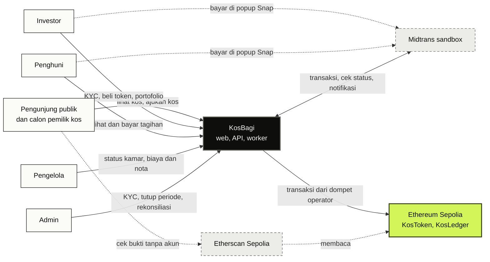
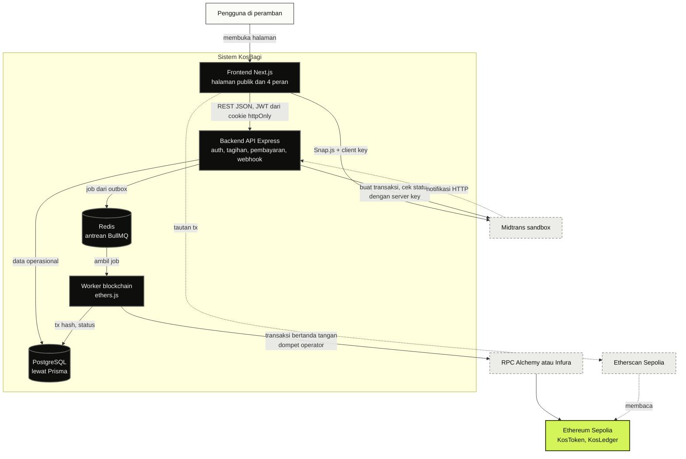
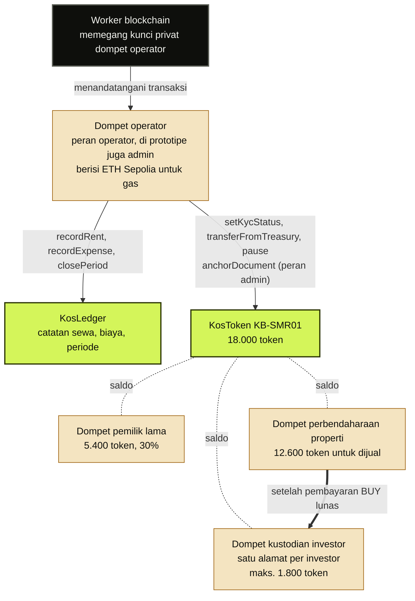
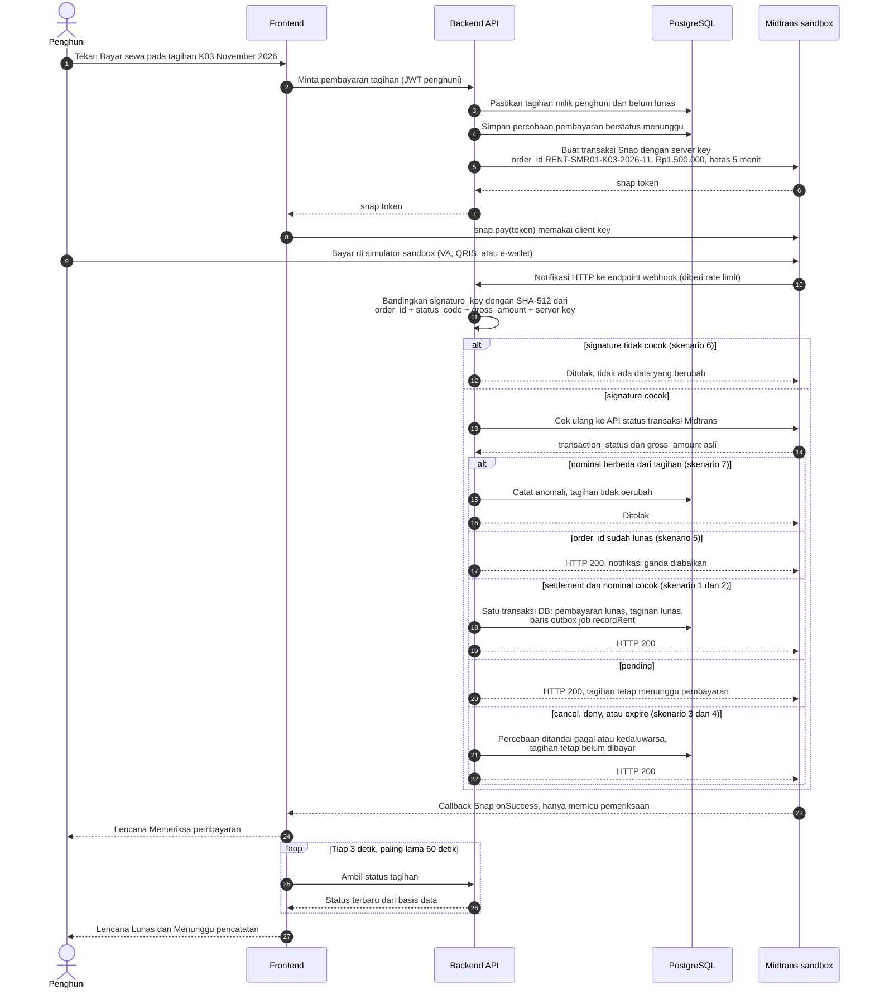
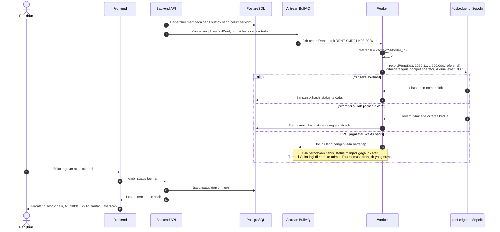
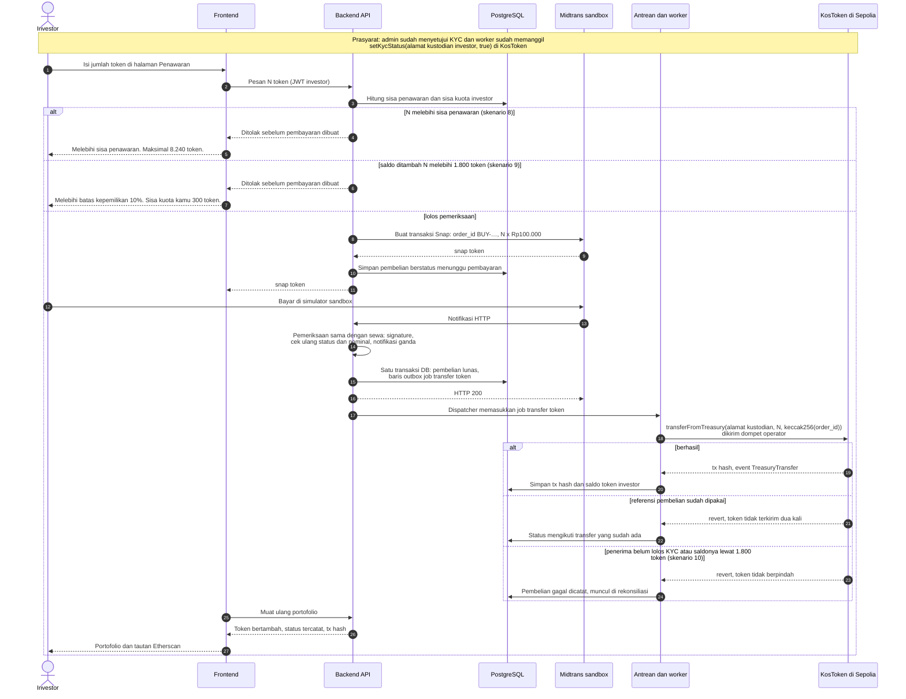
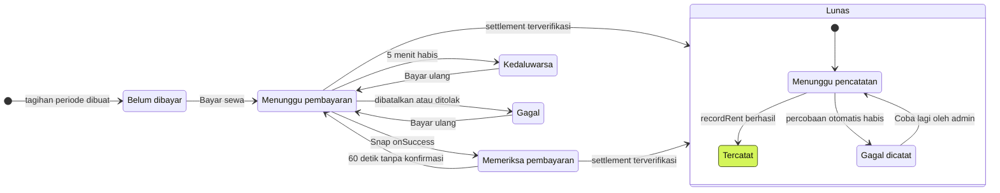
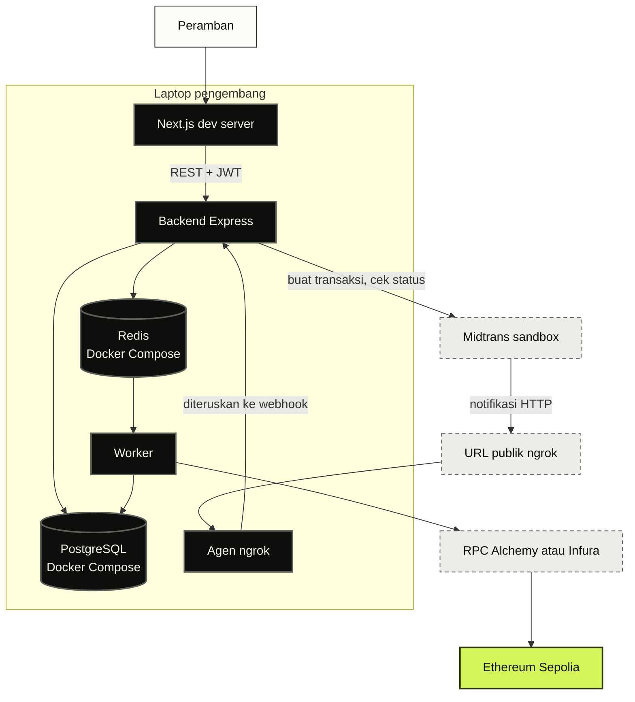
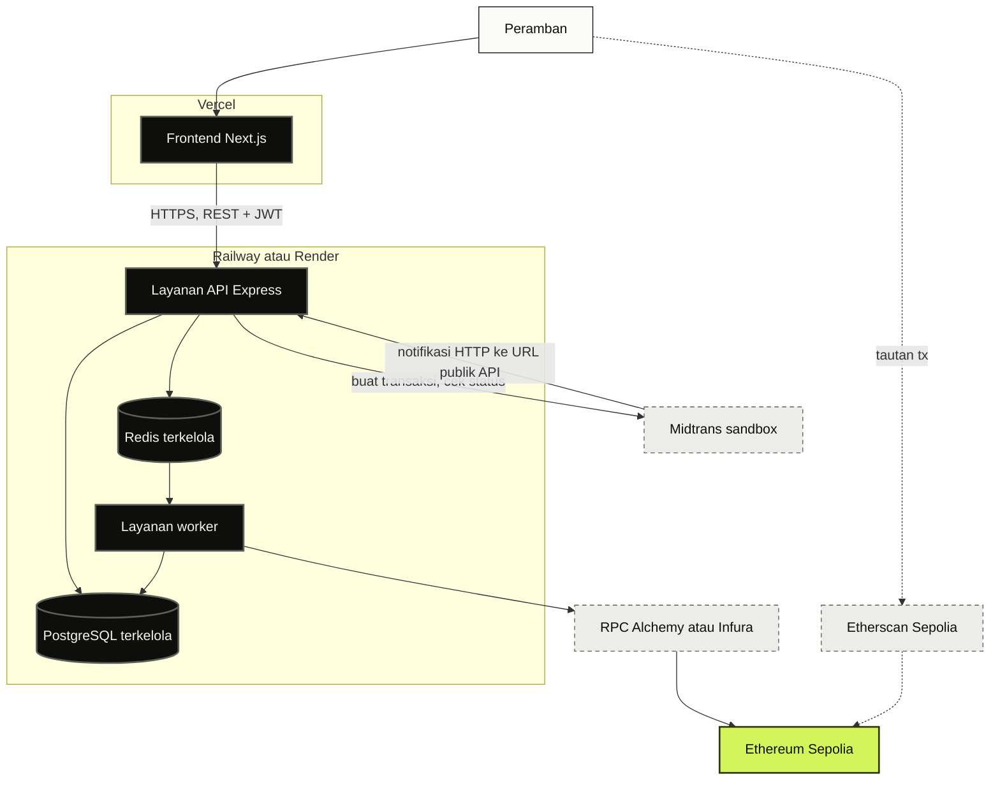

# Arsitektur KosBagi

Dokumen ini menggambarkan cara komponen KosBagi bekerja sama: siapa memakai apa, bagaimana pembayaran sewa sampai tercatat di blockchain, bagaimana investor membeli token, status apa yang tampil di layar, dan di mana aplikasi dijalankan. Semua diagram ditulis dengan Mermaid sehingga tampil langsung di GitHub.

Status: versi P2 (2 Nov 2026). Dokumen ini diperbarui bila alurnya berubah, paling lambat saat prototipe lengkap di P4.

Rincian teknis yang dimiliki dokumen lain:

- Endpoint, payload, dan alur webhook: [`docs/api/`](../api/).
- Fungsi, peran, dan aturan smart contract: [`docs/kontrak/`](../kontrak/).
- Struktur tabel basis data: [ERD](erd.md).

Bila ada perbedaan, dokumen API dan dokumen kontrak yang menjadi acuan, lalu diagram di sini disesuaikan.

## Daftar isi

1. [Konteks sistem](#1-konteks-sistem)
2. [Komponen](#2-komponen)
3. [Dompet dan token](#3-dompet-dan-token)
4. [Alur pembayaran sewa](#4-alur-pembayaran-sewa)
5. [Alur pembelian token](#5-alur-pembelian-token)
6. [Status yang tampil di layar](#6-status-yang-tampil-di-layar)
7. [Deployment](#7-deployment)
8. [Keputusan arsitektur](#8-keputusan-arsitektur)

## Arti warna di diagram

| Warna | Arti |
|---|---|
| Putih bergaris tinta | Pengguna |
| Hitam | Komponen yang dibangun KosBagi |
| Lime | Lapisan bukti di blockchain. Sama dengan aturan antarmuka: lime hanya untuk bukti |
| Kunyit | Dompet blockchain yang dipakai KosBagi |
| Abu bergaris putus-putus | Layanan pihak luar |

Pada diagram alir, panah penuh berarti permintaan atau aliran data, dan panah putus-putus berarti aliran yang dimulai pihak luar atau hanya membaca.

## 1. Konteks sistem

Gambaran paling luas: lima kelompok pengguna, sistem KosBagi sebagai satu kotak, dan tiga pihak luar.

- **Pengunjung publik** tidak perlu akun. Mereka membaca profil kos, mengajukan kos (calon pemilik), dan bisa mengecek catatan sewa langsung di Etherscan.
- **Empat peran yang masuk** (investor, penghuni, pengelola, admin) hanya berinteraksi dengan KosBagi. Akun pemilik kos tidak ada; pemilik mengajukan kos lewat halaman publik.
- **Pembayaran terjadi di halaman Midtrans** (popup Snap), bukan di server KosBagi. Data metode bayar tidak pernah melewati KosBagi.
- **KosBagi menulis ke Sepolia hanya lewat satu dompet operator.** Pengguna tidak pernah mengirim transaksi blockchain sendiri dan tidak perlu memegang ETH.
- **Etherscan membaca Sepolia secara mandiri**, jadi bukti bisa dicek tanpa harus memercayai KosBagi.

## 2. Komponen

Isi kotak KosBagi pada diagram konteks, beserta cara tiap komponen berhubungan.

| Komponen | Tugas | Teknologi | Jalur |
|---|---|---|---|
| Frontend | Halaman publik, halaman empat peran, popup Snap, route handler sesi dan penerus API. Peramban hanya memegang client key Midtrans dan URL API | Next.js App Router, Tailwind CSS, shadcn/ui | 4 |
| Backend API | Login dan peran, KYC dummy, tagihan, pembayaran, webhook, penawaran, biaya, periode, portofolio | Express 5, TypeScript, Prisma 7 | 2 (rekonsiliasi dan kalkulator keuangan: jalur 1) |
| PostgreSQL | Data operasional: pengguna, kamar, tagihan, pembayaran, outbox, tx hash | PostgreSQL | 2 |
| Redis + BullMQ | Antrean job blockchain dengan percobaan ulang | Redis, BullMQ | 2 (definisi antrean) |
| Worker blockchain | Mengambil job, mengirim transaksi lewat dompet operator, menyimpan tx hash | ethers.js | 3 |
| KosToken, KosLedger | Bukti on-chain: kepemilikan token, catatan sewa, biaya, dan penutupan periode | Solidity, OpenZeppelin | 3 |
| Midtrans sandbox | Halaman bayar Snap, API status transaksi, notifikasi HTTP | Layanan luar | - |
| RPC Alchemy atau Infura | Pintu masuk ke jaringan Sepolia, dengan penyedia cadangan bila satu gagal | Layanan luar | - |
| Etherscan Sepolia | Penjelajah blok publik untuk mengecek transaksi dan kontrak | Layanan luar | - |

Panah Frontend ke Backend API melewati route handler Next.js. Peramban memanggil `/api/backend/...` di server Next.js, lalu route handler mengambil JWT dari cookie httpOnly dan meneruskan permintaan ke backend. Token tidak pernah sampai ke JavaScript peramban (keputusan K9). Backend tidak pernah memanggil frontend. Satu-satunya pihak luar yang memulai panggilan ke backend adalah Midtrans lewat notifikasi HTTP.

## 3. Dompet dan token

Investor tidak memegang ETH dan tidak memakai MetaMask. Backend membuatkan satu dompet kustodian per investor, dan semua transaksi tulis dikirim oleh satu dompet operator.

| Dompet | Isi | Siapa yang mengendalikan | Catatan |
|---|---|---|---|
| Operator | ETH Sepolia untuk biaya gas, tanpa token | KosBagi; kunci privat hanya di environment worker | Pengirim semua transaksi tulis harian ke KosToken dan KosLedger. Di prototipe juga memegang peran admin KosToken (mengatur peran dan mencatat dokumen); kontrak memisahkan kedua peran sehingga admin bisa dipindah ke dompet lain tanpa mengubah kode |
| Pemilik lama | 5.400 token (30%) | Pemilik kos (alamat dummy di prototipe) | Dikecualikan dari batas 10% |
| Perbendaharaan properti | 12.600 token yang ditawarkan ke investor | Tidak perlu menandatangani: kontrak mengizinkan operator memindahkan token khusus dari alamat ini | Dikecualikan dari batas 10% |
| Kustodian investor | Token milik satu investor, paling banyak 1.800 | KosBagi, dibuat backend per investor | Harus lolos KYC (`setKycStatus`) sebelum bisa menerima token |

KosToken juga menyimpan **registri dokumen berversi**. Hash SHA-256 sertifikat dan laporan penilaian dicatat saat deploy, sedangkan perjanjian pengelolaan dicatat admin sesudahnya lewat `anchorDocument`. Setiap pencatatan memancarkan event `DocumentAnchored`; hash yang berlaku dibaca dengan `currentDocumentHash`, dan versi lama tidak pernah dihapus (`documentHistory`). Tab Dokumen di detail kos membandingkan hash berkas dengan hash yang berlaku ini.

Nama fungsi KosToken di atas mengikuti kontrak `KosToken.sol` P1 dan [rancangan kontrak](../kontrak/rancangan-kontrak.md). Nama fungsi KosLedger (`recordRent`, `recordExpense`, `closePeriod`) mengikuti proposal dan dibangun di P2; tanda tangan lengkapnya ada di [`docs/kontrak/`](../kontrak/).

KosToken mendelegasikan hak suara setiap pemegang ke dirinya sendiri secara otomatis. Karena itu saldo token pada blok penutupan periode bisa dibaca kembali dan dipakai sebagai dasar bagi hasil serta bobot voting.

## 4. Alur pembayaran sewa

Contoh: Sari Wulandari (penghuni kamar K03) membayar sewa November 2026 sebesar Rp1.500.000. Alurnya dibagi dua diagram supaya tetap terbaca: bagian A sampai tagihan lunas, bagian B sampai catatan on-chain dan tautan Etherscan. Keduanya tersambung lewat baris outbox yang ditulis di langkah A18.

### 4A. Dari tombol Bayar sewa sampai tagihan lunas

Hal yang perlu diperhatikan (nomor mengikuti angka pada diagram):

- **Langkah 2 sampai 6.** Backend memeriksa bahwa tagihan memang milik penghuni yang masuk dan belum lunas, menyimpan percobaan lebih dulu supaya kegagalan Midtrans tidak meninggalkan keadaan yang tidak dikenal, lalu membuat transaksi Snap dengan server key. Nominalnya tepat Rp1.500.000 karena penghuni tidak dikenai biaya tambahan. Batas bayar 5 menit dipakai supaya skenario kedaluwarsa bisa didemokan.
- **Langkah 8 dan 9.** Snap.js di peramban hanya memakai client key. Penghuni membayar di simulator sandbox Midtrans, bukan di halaman KosBagi.
- **Langkah 10 dan 11.** Notifikasi dari Midtrans adalah satu-satunya pemicu perubahan status. Signature dihitung ulang dengan server key yang hanya diketahui backend dan Midtrans, sehingga notifikasi palsu langsung ditolak (skenario 6).
- **Langkah 13 dan 14.** Walau signature cocok, backend tetap bertanya ulang ke API status transaksi Midtrans (`GET /v2/{order_id}/status`). Status dan nominal yang dipakai adalah jawaban API itu.
- **Langkah 15 sampai 22.** Lima cabang hasil: nominal tidak cocok dicatat sebagai anomali (skenario 7), notifikasi ganda diabaikan dengan HTTP 200 (skenario 5), pembayaran sah ditandai lunas (skenario 1 dan 2), status pending dibiarkan menunggu, sedangkan batal, ditolak, atau kedaluwarsa tidak mengubah tagihan (skenario 3 dan 4).
- **Langkah 18.** Status lunas dan baris outbox untuk job `recordRent` ditulis dalam satu transaksi basis data: keduanya tersimpan, atau tidak satu pun.
- **Langkah 23 sampai 27.** Callback Snap di peramban tidak pernah menandai lunas. Callback itu hanya memicu state klien Memeriksa pembayaran: frontend meminta status tagihan tiap 3 detik sampai 60 detik. Tanpa state ini penghuni melihat tagihan belum dibayar padahal baru membayar. Bila 60 detik habis tanpa konfirmasi, polling berhenti dan tampilan kembali mengikuti status dari backend.

Kode balasan HTTP untuk notifikasi yang ditolak ditetapkan di dokumentasi API (P2).

### 4B. Dari antrean sampai tautan Etherscan

- **Langkah 1 dan 2 (outbox).** Dispatcher memindahkan baris outbox ke antrean BullMQ. Bila Redis sedang mati, baris tetap ada di PostgreSQL dan dikirim ulang nanti, jadi job pencatatan tidak hilang walau tagihan sudah lunas.
- **Langkah 4.** Referensi on-chain adalah `keccak256(order_id)`: angka 32 byte yang bisa dicocokkan dengan basis data, tanpa nama penghuni.
- **Langkah 5.** Data yang dikirim hanya kamar, periode, nominal, dan referensi. Transaksi ditandatangani dompet operator; hanya alamat dengan peran operator yang boleh memanggil `recordRent` (skenario 11).
- **Langkah 8.** Bila job terulang, KosLedger menolak referensi yang sudah tercatat. Ini lapis ketiga pencegahan transaksi ganda (skenario 5).
- **Langkah 10.** Kegagalan RPC atau jaringan dicoba ulang dengan jeda yang makin panjang. Bila tetap gagal, halaman penghuni menampilkan "Pencatatan on-chain gagal" tanpa tombol, karena pengulangan adalah tugas operator di antrean admin (P4). Mengulang aman karena kontrak menolak catatan ganda. Pembayaran tetap lunas di sistem selama menunggu.
- **Langkah 15.** Tautan Etherscan berbentuk `https://sepolia.etherscan.io/tx/<tx hash>`, dan hash ditampilkan disingkat 6+4 karakter.

## 5. Alur pembelian token

Contoh: Dimas Pratama (investor) membeli N token KB-SMR01 seharga Rp100.000 per token. Polanya sama dengan pembayaran sewa, dengan awalan `order_id` `BUY-`.

- **Prasyarat KYC.** Persetujuan admin memicu job whitelist. Worker memanggil `setKycStatus` untuk alamat dompet kustodian investor, sehingga alamat itu boleh menerima token.
- **Langkah 3 sampai 7.** Batas sisa penawaran (skenario 8) dan batas 10% per investor (skenario 9) diperiksa backend **sebelum** transaksi Midtrans dibuat, jadi investor tidak pernah membayar untuk token yang tidak bisa diterimanya. Pesan galatnya sama dengan desain komponen "Kuota beli token" di Figma.
- **Langkah 13 sampai 16.** Webhook pembelian melewati pemeriksaan yang sama dengan sewa (bagian 4A).
- **Langkah 17 sampai 24.** `transferFromTreasury` memindahkan token dari dompet perbendaharaan ke dompet kustodian investor. Kontrak menolak referensi pembelian yang sama dipakai dua kali, dan tetap menegakkan KYC serta batas 10% (skenario 10). Cabang revert terakhir seharusnya tidak terjadi karena backend sudah memeriksa aturan yang sama; bila terjadi, pembelian muncul di halaman rekonsiliasi untuk ditangani admin.

## 6. Status yang tampil di layar

Antarmuka wajib menunjukkan dengan jelas apakah sebuah pembayaran sudah lunas dan apakah sudah tercatat on-chain. Diagram berikut memakai label yang sama dengan komponen "Status tagihan" dan "Status on-chain" di Figma.

Di basis data, tagihan hanya punya dua status: belum dibayar dan lunas. Menunggu pembayaran, Kedaluwarsa, dan Gagal adalah status percobaan pembayaran terakhir yang ditampilkan pada slip tagihan. Memeriksa pembayaran tidak ada di basis data sama sekali: state ini hanya hidup di klien, dari Snap `onSuccess` sampai webhook masuk, jadi hilang bila halaman dimuat ulang. Tombol Lanjutkan pembayaran membuka Snap dengan token yang sama, sedangkan Bayar ulang membuat percobaan baru dengan `order_id` bersufiks `-2`, `-3` (Midtrans menolak `order_id` yang sama dipakai dua kali). Tagihannya tetap satu.

| Kelompok | Label di layar | Warna lencana | Teks pendukung atau aksi |
|---|---|---|---|
| Tagihan | Belum dibayar | Abu | Jatuh tempo, tombol Bayar sewa |
| Tagihan | Menunggu pembayaran | Kunyit | "Selesaikan di halaman Midtrans sebelum waktu habis", kotak Sisa waktu (mis. 04:12), tombol Lanjutkan pembayaran |
| Tagihan | Memeriksa pembayaran | Nila | "Menunggu konfirmasi Midtrans. Biasanya beberapa detik. Halaman ini diperbarui sendiri.", tanpa tombol |
| Tagihan | Lunas | Lime | Waktu dan metode bayar, mis. "Dibayar 9 Nov 2026, 10.42 lewat virtual account" |
| Tagihan | Kedaluwarsa | Saga | "Batas 5 menit terlewat. Tagihan tetap belum dibayar.", tombol Bayar ulang |
| Tagihan | Gagal | Saga | "Midtrans menolak atau kamu membatalkan pembayaran. Tagihan tetap belum dibayar.", tombol Bayar ulang |
| On-chain | Menunggu pencatatan | Nila | "Transaksi sedang dikirim ke jaringan Sepolia. Biasanya selesai dalam 1 menit." |
| On-chain | Tercatat | Lime | Tx hash 6+4, nomor blok, tautan "Lihat di Etherscan" |
| On-chain | Gagal dicatat | Saga | "Jaringan Sepolia tidak merespons. Pembayaranmu tetap lunas di sistem." Penghuni tidak punya tombol; Coba lagi ada di antrean admin (P4) |
| KYC | Belum mengajukan, Diajukan, Disetujui, Ditolak | Abu, nila, lime, saga | Disetujui memicu whitelist di KosToken |

Lime hanya muncul pada status yang menjadi bukti: Lunas, Tercatat, dan Disetujui.

## 7. Deployment

### 7A. Lingkungan pengembangan (P1 sampai P4)

- PostgreSQL dan Redis berjalan di Docker Compose (`docker compose up`).
- Midtrans tidak bisa menjangkau `localhost`. Agen ngrok membuka URL publik HTTPS yang meneruskan notifikasi ke endpoint webhook di laptop. URL itu dipasang sebagai Payment Notification URL di dashboard Midtrans sandbox dan perlu diperbarui bila URL ngrok berganti.
- Worker berjalan sebagai proses terpisah dari server API, jadi pengiriman transaksi blockchain yang lama tidak menahan permintaan HTTP.

### 7B. Lingkungan demo (P5)

- Frontend di Vercel. API dan worker di Railway atau Render sebagai dua layanan terpisah, bersama PostgreSQL dan Redis terkelola. Pilihan penyedia diputuskan di P5.
- Saat demo, ngrok tidak dipakai lagi: Payment Notification URL diarahkan ke URL publik layanan API.

### Letak kunci dan konfigurasi

| Kunci atau konfigurasi | Disimpan di | Boleh sampai ke peramban |
|---|---|---|
| Client key Midtrans sandbox | Environment frontend (`NEXT_PUBLIC_*`) | Ya, memang dipakai Snap.js |
| JWT sesi pengguna | Cookie httpOnly `kosbagi_session`, diatur route handler Next.js | Terkirim otomatis, tetapi tidak bisa dibaca JavaScript |
| URL API | Environment frontend (`NEXT_PUBLIC_*`) | Ya |
| Server key Midtrans sandbox | Environment backend | Tidak |
| Secret JWT | Environment backend | Tidak |
| URL PostgreSQL dan Redis | Environment backend dan worker | Tidak |
| Kunci privat dompet operator | Environment worker | Tidak |
| Seed dompet kustodian | Environment backend dan worker | Tidak |
| URL RPC (memuat API key penyedia) | Environment worker | Tidak |

Repositori hanya berisi `.env.example` dengan nilai contoh. Semua yang diawali `NEXT_PUBLIC_` ikut terkirim ke peramban, jadi tidak boleh berisi rahasia.

## 8. Keputusan arsitektur

### K1. Webhook Midtrans adalah satu-satunya pintu perubahan status pembayaran

- **Keputusan:** tagihan dan pembelian hanya menjadi lunas setelah notifikasi Midtrans lolos verifikasi signature dan cek ulang status serta nominal ke API Midtrans.
- **Alasan:** callback Snap berjalan di peramban dan bisa dipalsukan atau terputus. Notifikasi server ke server bisa diverifikasi dengan server key yang tidak pernah keluar dari backend.
- **Akibat:** frontend harus memuat ulang status setelah popup ditutup, dan pengembangan lokal membutuhkan ngrok.

### K2. Pencatatan on-chain lewat antrean dengan percobaan ulang

- **Keputusan:** webhook hanya menandai lunas dan menulis baris outbox. Transaksi blockchain dikirim worker dari antrean BullMQ dengan percobaan ulang berjeda.
- **Alasan:** transaksi Sepolia butuh waktu belasan detik sampai beberapa menit dan RPC bisa gagal, sedangkan webhook harus cepat dibalas. Outbox di transaksi basis data yang sama menjamin job tidak hilang walau Redis sedang mati.
- **Akibat:** ada jeda antara Lunas dan Tercatat. Jeda ini sengaja ditampilkan (status Menunggu pencatatan), bukan disembunyikan.

### K3. Tiga lapis pencegahan transaksi ganda

| Lapis | Tempat | Yang dicegah |
|---|---|---|
| 1 | Constraint unik `order_id` di PostgreSQL | Dua baris pembayaran dengan `order_id` sama |
| 2 | Deduplikasi di webhook | Notifikasi berulang untuk `order_id` yang sudah lunas: diabaikan, dibalas HTTP 200 |
| 3 | Kontrak | `recordRent` menolak referensi `keccak256(order_id)` yang sudah tercatat; `transferFromTreasury` menolak referensi pembelian yang sudah dipakai |

- **Alasan:** Midtrans bisa mengirim notifikasi lebih dari sekali dan worker bisa mengulang job. Tiap lapis menutup celah yang berbeda, sehingga satu pembayaran hanya menghasilkan satu catatan lunas dan satu catatan on-chain (skenario 5).

### K4. Tidak ada data pribadi on-chain

- **Keputusan:** data on-chain hanya kode properti, nomor kamar, periode, nominal, `keccak256(order_id)`, hash nota, dan hash dokumen properti. Nama, nomor identitas, rekening, dan berkas nota tetap di server KosBagi.
- **Alasan:** blockchain publik dan permanen. Data yang sudah tercatat tidak bisa dihapus, padahal UU PDP memberi hak penghapusan data pribadi.
- **Catatan:** hash `order_id` bukan untuk merahasiakan (formatnya bisa ditebak dan isinya memang bukan data pribadi). Hash dipakai sebagai referensi berukuran tetap 32 byte yang bisa dicocokkan dengan basis data saat rekonsiliasi.

### K5. Dompet kustodian per investor dan satu dompet operator

- **Keputusan:** investor tidak memegang ETH atau kunci. Backend membuat dompet kustodian per investor; semua transaksi dikirim dompet operator yang membayar gas.
- **Alasan:** calon investor mahasiswa tidak perlu memasang MetaMask atau membeli ETH. Karena setiap investor punya alamat sendiri, KYC dan batas 10% tetap bisa ditegakkan kontrak per alamat.
- **Akibat:** investor bergantung pada KosBagi untuk menggerakkan tokennya (model kustodian). Hal ini diimbangi saldo dan riwayat yang bisa diaudit siapa pun di Etherscan. Dompet mandiri menjadi pilihan fase berikutnya.

### K6. Kunci rahasia hanya di backend dan worker

- **Keputusan:** frontend hanya memegang client key Midtrans dan URL API. Server key, secret JWT, kunci privat operator, dan seed kustodian hanya ada di environment backend atau worker.
- **Alasan:** semua isi bundle frontend bisa dibaca siapa pun yang membuka situs.

### K7. Basis data sebagai sumber operasional, blockchain sebagai bukti

- **Keputusan:** status operasional (tagihan, pembayaran, saldo bagi hasil) dibaca dari PostgreSQL. Blockchain menyimpan bukti yang tidak bisa diubah. Halaman rekonsiliasi mencocokkan Midtrans, basis data, dan blockchain.
- **Alasan:** membaca blockchain lambat dan tidak cocok untuk setiap tampilan, tetapi bukti harus bisa dicek pihak ketiga. Rekonsiliasi menunjukkan bila ketiganya tidak sama.

### K8. Testnet, sandbox, dan data dummy

- **Keputusan:** hanya Midtrans sandbox dan Ethereum Sepolia, dengan data dummy.
- **Alasan:** aturan tugas akhir. Tidak ada uang nyata, token bernilai, KTP, atau nomor rekening asli. Antarmuka menegaskannya lewat banner "Mode sandbox: data dummy, tanpa uang nyata".

### K9. Sesi disimpan di cookie httpOnly, peramban tidak pernah memegang JWT

- **Keputusan:** `POST /api/session` di Next.js meneruskan login ke backend dan menyimpan JWT di cookie httpOnly `kosbagi_session`. Semua panggilan data dari peramban lewat `/api/backend/[...path]`, yang menempelkan header `Authorization`. Halaman peran dijaga `proxy.ts` sebelum dirender, lalu sesi diverifikasi ke backend lewat `GET /auth/me`.
- **Alasan:** token di `localStorage` bisa dibaca skrip apa pun yang berjalan di halaman, termasuk pustaka pihak ketiga. Cookie httpOnly tidak bisa dibaca JavaScript, dan `SameSite=Lax` ditambah pemeriksaan `Origin` menutup CSRF pada permintaan yang mengubah data.
- **Akibat:** ada satu lompatan tambahan lewat server Next.js. `proxy.ts` hanya membaca isi token tanpa memverifikasi tanda tangan, karena `JWT_SECRET` hanya ada di backend, jadi hasilnya dipakai untuk mengarahkan halaman saja. Keputusan akses data tetap di backend.
