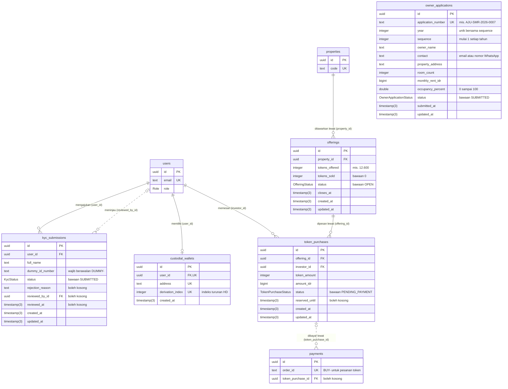
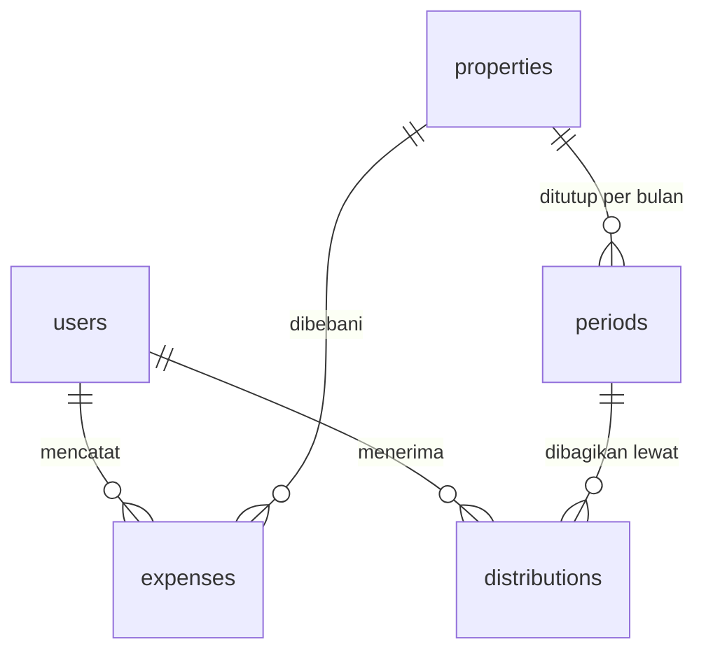

# ERD KosBagi

Diagram entitas dan relasi (ERD) basis data KosBagi. ERD ini disusun dari [`backend/prisma/schema.prisma`](../../backend/prisma/schema.prisma) dan migrasinya, [`20261029120000_init`](../../backend/prisma/migrations/20261029120000_init/migration.sql) serta [`20261102120000_skema_v2`](../../backend/prisma/migrations/20261102120000_skema_v2/migration.sql). Bila ada perbedaan, skema Prisma yang menjadi acuan dan ERD ini disesuaikan.

Status: skema v2 (P2, 2 Nov 2026) dengan 13 tabel. Empat tabel v1 (`users`, `properties`, `rooms`, `bills`) tidak berubah; sembilan tabel baru mengurus pembayaran, antrean blockchain, KYC dummy, penawaran token, dan pengajuan pemilik kos. Tabel P4 masih berupa rencana dan dipisahkan di bagian [Rencana entitas P4](#rencana-entitas-p4).

## Cara membaca

Setiap kotak adalah satu tabel PostgreSQL. Setiap baris di dalam kotak berisi tipe kolom, nama kolom, kunci, dan keterangan singkat.

| Kunci | Arti |
|---|---|
| `PK` | Primary key, pengenal unik setiap baris |
| `FK` | Foreign key, merujuk ke primary key tabel lain |
| `UK` | Unique key, nilainya tidak boleh kembar di seluruh tabel |

Ujung garis memakai notasi crow's foot. Simbol yang menempel pada sebuah tabel menyatakan berapa baris tabel itu yang bisa terhubung dengan satu baris di ujung lainnya.

| Simbol di ujung garis | Arti |
|---|---|
| Dua garis tegak | Tepat satu |
| Lingkaran dan satu garis tegak | Nol atau satu |
| Lingkaran dan kaki gagak | Nol atau banyak |
| Satu garis tegak dan kaki gagak | Satu atau banyak |

Garis penuh berarti kolom foreign key wajib diisi, sehingga baris anak tidak bisa ada tanpa induknya. Garis putus-putus berarti foreign key boleh kosong.

Nama model di kode memakai camelCase, sedangkan nama tabel dan kolom di PostgreSQL memakai snake_case (lewat `@@map` dan `@map`):

| Model Prisma | Tabel | Contoh field dan kolom |
|---|---|---|
| `User` | `users` | `passwordHash` menjadi `password_hash` |
| `Property` | `properties` | `valuationIdr` menjadi `valuation_idr` |
| `Room` | `rooms` | `monthlyRentIdr` menjadi `monthly_rent_idr` |
| `Bill` | `bills` | `amountIdr` menjadi `amount_idr` |
| `Payment` | `payments` | `orderId` menjadi `order_id` |
| `PaymentAnomaly` | `payment_anomalies` | `expectedAmountIdr` menjadi `expected_amount_idr` |
| `OutboxJob` | `outbox_jobs` | `dedupeKey` menjadi `dedupe_key` |
| `ChainTransaction` | `chain_transactions` | `txHash` menjadi `tx_hash` |
| `KycSubmission` | `kyc_submissions` | `dummyIdNumber` menjadi `dummy_id_number` |
| `CustodialWallet` | `custodial_wallets` | `derivationIndex` menjadi `derivation_index` |
| `Offering` | `offerings` | `tokensOffered` menjadi `tokens_offered` |
| `TokenPurchase` | `token_purchases` | `reservedUntil` menjadi `reserved_until` |
| `OwnerApplication` | `owner_applications` | `applicationNumber` menjadi `application_number` |

## Diagram ERD v2 (P2)

Agar tetap terbaca, diagram dibagi dua. Bagian A berisi data sewa dan pembayaran, bagian B berisi investor dan penawaran token. Tabel `users`, `properties`, dan `payments` muncul di kedua bagian dengan isi kolom yang sama.

### A. Sewa, pembayaran, dan pencatatan on-chain

```mermaid
erDiagram
    users ||--o{ bills : "ditagih (tenant_id)"
    users |o..o| rooms : "menempati (tenant_id)"
    users |o..o{ properties : "mengelola (manager_id)"
    properties ||--o{ rooms : "memiliki (property_id)"
    rooms ||--o{ bills : "ditagihkan (room_id)"
    bills |o..o{ payments : "dibayar lewat (bill_id)"
    payments |o..o{ payment_anomalies : "memicu (payment_id)"
    payments |o..o| outbox_jobs : "melahirkan (payment_id)"
    outbox_jobs ||--o{ chain_transactions : "dikirim sebagai (outbox_job_id)"

    users {
        uuid id PK "UUID v7"
        text name
        text email UK "email login"
        text password_hash "hash scrypt"
        Role role "INVESTOR, TENANT, MANAGER, ADMIN"
        timestamp(3) created_at
        timestamp(3) updated_at
    }
    properties {
        uuid id PK
        text code UK "mis. SMR01"
        text slug UK "mis. sumbersari-01"
        text name
        text address
        bigint valuation_idr "rupiah, mis. 1.800.000.000"
        text token_symbol UK "mis. KB-SMR01"
        integer total_tokens "mis. 18.000"
        bigint token_price_idr "rupiah, mis. 100.000"
        integer owner_tokens "mis. 5.400"
        integer max_tokens_per_investor "mis. 1.800"
        uuid manager_id FK "boleh kosong"
        timestamp(3) created_at
        timestamp(3) updated_at
    }
    rooms {
        uuid id PK
        uuid property_id FK "unik bersama number"
        text number "K01 sampai K10"
        bigint monthly_rent_idr "rupiah, mis. 1.500.000"
        RoomStatus status "bawaan VACANT"
        uuid tenant_id FK, UK "boleh kosong"
        timestamp(3) created_at
        timestamp(3) updated_at
    }
    bills {
        uuid id PK
        uuid room_id FK "unik bersama period"
        uuid tenant_id FK
        char(7) period "YYYY-MM, mis. 2026-11"
        bigint amount_idr "rupiah, mis. 1.500.000"
        BillStatus status "bawaan UNPAID"
        date due_date
        timestamp(3) paid_at "boleh kosong"
        timestamp(3) created_at
        timestamp(3) updated_at
    }
    payments {
        uuid id PK
        text order_id UK "mis. RENT-SMR01-K03-2026-11"
        uuid bill_id FK "unik bersama attempt, boleh kosong"
        uuid token_purchase_id FK "unik bersama attempt, boleh kosong"
        integer attempt "percobaan ke berapa, mulai 1"
        bigint amount_idr
        PaymentStatus status "bawaan PENDING"
        text method "payment_type Midtrans, boleh kosong"
        text snap_token "boleh kosong"
        text snap_redirect_url "boleh kosong"
        text provider_status "boleh kosong"
        text provider_transaction_id "boleh kosong"
        timestamp(3) expires_at "batas bayar"
        timestamp(3) paid_at "boleh kosong"
        timestamp(3) created_at
        timestamp(3) updated_at
    }
    payment_anomalies {
        uuid id PK
        PaymentAnomalyType type "unik bersama order_id"
        text order_id "teks apa adanya"
        uuid payment_id FK "boleh kosong"
        bigint expected_amount_idr "boleh kosong"
        bigint received_amount_idr "boleh kosong"
        text provider_status "boleh kosong"
        text note "tanpa data pribadi, boleh kosong"
        integer occurrences "bawaan 1"
        timestamp(3) created_at
        timestamp(3) updated_at
    }
    outbox_jobs {
        uuid id PK
        OutboxJobType type
        text dedupe_key UK "mis. record-rent:<id tagihan>"
        jsonb payload "tanpa data pribadi"
        uuid payment_id FK, UK "boleh kosong"
        OutboxJobStatus status "bawaan PENDING"
        integer attempts "bawaan 0"
        text last_error "boleh kosong"
        timestamp(3) dispatched_at "boleh kosong"
        timestamp(3) created_at
        timestamp(3) updated_at
    }
    chain_transactions {
        uuid id PK
        uuid outbox_job_id FK
        text reference "mis. keccak256(order_id)"
        text tx_hash UK "boleh kosong"
        bigint block_number "boleh kosong"
        ChainTransactionStatus status "bawaan PENDING"
        integer attempts "bawaan 0"
        text last_error "boleh kosong"
        timestamp(3) created_at
        timestamp(3) updated_at
    }
```

### B. Investor, penawaran, dan pengajuan pemilik

`owner_applications` berdiri sendiri tanpa foreign key karena pemilik kos tidak punya akun.

Kolom yang wajib diisi adalah semua kolom yang tidak bertanda "boleh kosong".

## Entitas dan kolom penting

### `users` (model `User`)

Akun pengguna aplikasi untuk keempat peran. Semua akun di prototipe adalah data dummy. Data pribadi hanya disimpan di tabel ini dan tidak pernah dikirim ke blockchain.

| Kolom | Tipe | Keterangan |
|---|---|---|
| `id` | `uuid` | Primary key, UUID v7 yang dibuat Prisma saat baris disimpan |
| `name` | `text` | Nama tampilan, mis. Sari Wulandari |
| `email` | `text` | Unik, dipakai untuk masuk. Akun dummy memakai domain `kosbagi.test` |
| `password_hash` | `text` | Hash scrypt dari kata sandi, bukan kata sandinya |
| `role` | `Role` | Peran: menentukan menu yang tampil dan endpoint yang boleh dipanggil |
| `created_at`, `updated_at` | `timestamp(3)` | Waktu dibuat dan terakhir diubah |

### `properties` (model `Property`)

Kos yang ditokenisasi. Di prototipe hanya ada satu baris: Kos Sumbersari 01.

| Kolom | Tipe | Keterangan |
|---|---|---|
| `code` | `text` | Unik. Kode singkat yang dipakai di `order_id` dan data on-chain, mis. `SMR01` |
| `slug` | `text` | Unik. Penanda URL halaman publik, mis. `sumbersari-01` untuk `/kos/sumbersari-01` |
| `valuation_idr` | `bigint` | Nilai properti hasil penilaian dalam rupiah, mis. 1.800.000.000 |
| `token_symbol` | `text` | Unik. Simbol token ERC-20 properti ini, mis. `KB-SMR01` |
| `total_tokens` | `integer` | Seluruh token yang diterbitkan, mis. 18.000 |
| `token_price_idr` | `bigint` | Harga satu token dalam rupiah, mis. 100.000 |
| `owner_tokens` | `integer` | Token yang tetap dipegang pemilik lama, mis. 5.400 (30%); sisanya dijual ke investor |
| `max_tokens_per_investor` | `integer` | Batas kepemilikan per investor, mis. 1.800 (10%); juga ditegakkan di kontrak `KosToken` |
| `manager_id` | `uuid` | Pengguna berperan MANAGER yang mengelola properti ini. Boleh kosong |

### `rooms` (model `Room`)

Kamar di sebuah properti, mis. K03 di Kos Sumbersari 01.

| Kolom | Tipe | Keterangan |
|---|---|---|
| `property_id` | `uuid` | Properti pemilik kamar. Wajib |
| `number` | `text` | Nomor kamar K01 sampai K10, unik dalam satu properti |
| `monthly_rent_idr` | `bigint` | Sewa per bulan dalam rupiah, mis. 1.500.000 |
| `status` | `RoomStatus` | Status hunian, bawaan `VACANT` |
| `tenant_id` | `uuid` | Penghuni saat ini. Boleh kosong dan unik, sehingga satu penghuni hanya menempati satu kamar |

### `bills` (model `Bill`)

Tagihan sewa satu kamar untuk satu periode bulan.

| Kolom | Tipe | Keterangan |
|---|---|---|
| `room_id` | `uuid` | Kamar yang ditagih. Wajib |
| `tenant_id` | `uuid` | Penghuni yang ditagih, dicatat saat tagihan dibuat. Wajib |
| `period` | `char(7)` | Periode sewa berformat `YYYY-MM`, mis. `2026-11` |
| `amount_idr` | `bigint` | Nominal tagihan dalam rupiah. Webhook menolak pembayaran yang nominalnya berbeda |
| `status` | `BillStatus` | Bawaan `UNPAID`; menjadi `PAID` hanya lewat webhook Midtrans yang terverifikasi |
| `due_date` | `date` | Tanggal jatuh tempo, tanpa jam, mis. 10 Nov 2026 |
| `paid_at` | `timestamp(3)` | Waktu tagihan menjadi lunas. Kosong selama belum dibayar |

### `payments` (model `Payment`)

Satu percobaan pembayaran Midtrans. Satu tagihan bisa punya beberapa percobaan karena Midtrans menolak `order_id` yang sama dipakai dua kali, sedangkan penghuni boleh membayar ulang.

| Kolom | Tipe | Keterangan |
|---|---|---|
| `order_id` | `text` | Unik per percobaan: `RENT-SMR01-K03-2026-11`, lalu bersufiks `-2`, `-3`. Awalan `BUY-` untuk pesanan token |
| `bill_id`, `token_purchase_id` | `uuid` | Sasaran pembayaran. Tepat satu terisi, dijaga constraint CHECK di SQL migrasi |
| `attempt` | `integer` | Nomor percobaan untuk sasaran yang sama, mulai dari 1 |
| `amount_idr` | `bigint` | Nominal yang ditagihkan ke Midtrans |
| `status` | `PaymentStatus` | Status percobaan, lihat bagian Enum. `PENDING` yang melewati `expires_at` dibaca sebagai kedaluwarsa |
| `method` | `text` | `payment_type` dari Midtrans, mis. `bank_transfer`, `qris`. Kosong sampai metode dipilih |
| `snap_token`, `snap_redirect_url` | `text` | Kosong selama transaksi belum berhasil dibuat di Midtrans |
| `provider_status`, `provider_transaction_id` | `text` | `transaction_status` terakhir dan `transaction_id` dari Midtrans, untuk telusur dan rekonsiliasi |
| `expires_at` | `timestamp(3)` | Batas bayar, 5 menit sejak transaksi dibuat. Hitung mundur di layar membaca nilai ini |
| `paid_at` | `timestamp(3)` | Waktu terbayar. Kosong selama belum dibayar |

### `payment_anomalies` (model `PaymentAnomaly`)

Notifikasi Midtrans bersignature sah yang tidak diproses normal dan perlu ditinjau manusia. Tagihan tidak berubah. Satu baris per order per jenis; notifikasi ulang hanya menaikkan `occurrences`.

| Kolom | Tipe | Keterangan |
|---|---|---|
| `type` | `PaymentAnomalyType` | Jenis anomali, lihat bagian Enum |
| `order_id` | `text` | Teks apa adanya, bukan foreign key, karena `UNKNOWN_ORDER` tidak punya baris pembayaran |
| `payment_id` | `uuid` | Pembayaran terkait. Boleh kosong |
| `expected_amount_idr`, `received_amount_idr` | `bigint` | Nominal yang diharapkan dan yang diterima |
| `provider_status` | `text` | `transaction_status` menurut API status Midtrans |
| `note` | `text` | Keterangan untuk peninjau, tanpa data pribadi |
| `occurrences` | `integer` | Berapa kali notifikasi yang sama diterima |

### `outbox_jobs` (model `OutboxJob`)

Job blockchain yang ditulis dalam satu transaksi basis data dengan perubahan statusnya (pola outbox). Dispatcher memindahkannya ke antrean BullMQ, jadi job tidak hilang walau Redis sedang mati.

| Kolom | Tipe | Keterangan |
|---|---|---|
| `type` | `OutboxJobType` | Jenis job blockchain |
| `dedupe_key` | `text` | Unik. Mencegah job ganda untuk sumber yang sama, mis. `record-rent:<id tagihan>` |
| `payload` | `jsonb` | Isi job sesuai `src/queue/jobs.ts`. Tidak boleh memuat data pribadi |
| `payment_id` | `uuid` | Pembayaran asal job untuk `RECORD_RENT` dan `TRANSFER_TOKENS`. Boleh kosong dan unik |
| `status` | `OutboxJobStatus` | Status pengiriman ke antrean, bukan status transaksi di blockchain |
| `attempts`, `last_error` | `integer`, `text` | Berapa kali gagal masuk antrean dan galat terakhirnya |
| `dispatched_at` | `timestamp(3)` | Waktu masuk antrean |

### `chain_transactions` (model `ChainTransaction`)

Transaksi di Sepolia. Satu job bisa menghasilkan beberapa percobaan transaksi. Baris ini sumber status on-chain yang tampil di layar.

| Kolom | Tipe | Keterangan |
|---|---|---|
| `outbox_job_id` | `uuid` | Job asal. Wajib |
| `reference` | `text` | Referensi on-chain, mis. `keccak256(order_id)` |
| `tx_hash` | `text` | Unik. Kosong sampai transaksi berhasil dikirim ke jaringan |
| `block_number` | `bigint` | Nomor blok tempat transaksi tercatat |
| `status` | `ChainTransactionStatus` | Menunggu, tercatat, atau gagal |
| `attempts`, `last_error` | `integer`, `text` | Jumlah percobaan dan galat terakhir |

### `kyc_submissions` (model `KycSubmission`)

Pengajuan KYC dummy. Investor yang ditolak boleh mengajukan lagi, jadi satu investor bisa punya banyak baris. Label "Belum mengajukan" di layar berarti belum ada baris.

| Kolom | Tipe | Keterangan |
|---|---|---|
| `user_id` | `uuid` | Investor yang mengajukan. Wajib |
| `full_name` | `text` | Nama sesuai isian |
| `dummy_id_number` | `text` | Nomor identitas dummy, wajib berawalan `DUMMY-`. Bukan nomor KTP |
| `status` | `KycStatus` | Bawaan `SUBMITTED` |
| `rejection_reason` | `text` | Alasan penolakan. Boleh kosong |
| `reviewed_by_id`, `reviewed_at` | `uuid`, `timestamp(3)` | Admin peninjau dan waktu peninjauan. Boleh kosong |

### `custodial_wallets` (model `CustodialWallet`)

Dompet kustodian investor. Kunci privat tidak disimpan di sini: diturunkan dari seed di environment memakai `derivation_index`.

| Kolom | Tipe | Keterangan |
|---|---|---|
| `user_id` | `uuid` | Investor pemilik. Unik: satu investor punya nol atau satu dompet |
| `address` | `text` | Unik. Alamat Ethereum |
| `derivation_index` | `integer` | Unik. Indeks turunan HD, satu indeks hanya dipakai satu investor |

### `offerings` (model `Offering`)

Penawaran token satu properti, mis. 12.600 token KB-SMR01.

| Kolom | Tipe | Keterangan |
|---|---|---|
| `property_id` | `uuid` | Properti yang ditawarkan. Wajib |
| `tokens_offered`, `tokens_sold` | `integer` | Token yang ditawarkan dan yang sudah terjual |
| `status` | `OfferingStatus` | Bawaan `OPEN` |
| `closes_at` | `timestamp(3)` | Batas waktu penawaran |

### `token_purchases` (model `TokenPurchase`)

Pesanan token seorang investor. Dibayar lewat baris `payments` berawalan `BUY-` (P3).

| Kolom | Tipe | Keterangan |
|---|---|---|
| `offering_id`, `investor_id` | `uuid` | Penawaran dan investor pemesan. Wajib |
| `token_amount` | `integer` | Jumlah token yang dipesan |
| `amount_idr` | `bigint` | Nominal pesanan |
| `status` | `TokenPurchaseStatus` | Bawaan `PENDING_PAYMENT` |
| `reserved_until` | `timestamp(3)` | Pesanan belum dibayar ikut mengurangi sisa penawaran dan kuota investor sampai waktu ini |

### `owner_applications` (model `OwnerApplication`)

Pengajuan pemilik kos dari halaman publik `/pemilik`. Pemilik kos tidak punya akun, jadi tabel ini tidak punya foreign key.

| Kolom | Tipe | Keterangan |
|---|---|---|
| `application_number` | `text` | Unik. Nomor untuk pemilik, mis. `AJU-SMR-2026-0007` |
| `year`, `sequence` | `integer` | Pembentuk nomor. Urutan mulai lagi dari 1 setiap tahun |
| `owner_name`, `contact`, `property_address` | `text` | Isian form. `contact` berisi email, atau nomor WhatsApp berisi angka saja |
| `room_count`, `monthly_rent_idr`, `occupancy_percent` | `integer`, `bigint`, `double` | Data kos dummy. Okupansi 0 sampai 100 persen |
| `status` | `OwnerApplicationStatus` | Lima tahap pengajuan, bawaan `SUBMITTED` |
| `submitted_at` | `timestamp(3)` | Waktu pengajuan |

## Relasi

| Relasi | Kardinalitas | Foreign key | Bila induk dihapus | Arti |
|---|---|---|---|---|
| `properties` ke `rooms` | Satu properti punya nol atau banyak kamar; setiap kamar tepat satu properti | `rooms.property_id` | Ditolak (RESTRICT) | Properti yang masih punya kamar tidak bisa dihapus |
| `rooms` ke `bills` | Satu kamar punya nol atau banyak tagihan, paling banyak satu per periode | `bills.room_id` | Ditolak (RESTRICT) | Tagihan adalah catatan keuangan, jadi kamarnya tidak boleh hilang |
| `users` ke `bills` | Satu penghuni punya nol atau banyak tagihan; setiap tagihan tepat satu penghuni | `bills.tenant_id` | Ditolak (RESTRICT) | Riwayat siapa yang ditagih tetap terjaga |
| `users` ke `rooms` | Satu pengguna menempati nol atau satu kamar; satu kamar ditempati nol atau satu penghuni | `rooms.tenant_id` (unik) | Dikosongkan (SET NULL) | Kamar menjadi kosong bila akun penghuni dihapus |
| `users` ke `properties` | Satu pengelola mengelola nol atau banyak properti; satu properti punya nol atau satu pengelola | `properties.manager_id` | Dikosongkan (SET NULL) | Properti tetap ada walau pengelolanya dihapus |
| `bills` ke `payments` | Satu tagihan punya nol atau banyak percobaan, paling banyak satu berstatus `PAID` | `payments.bill_id` | Ditolak (RESTRICT) | Jejak pembayaran tidak boleh hilang |
| `token_purchases` ke `payments` | Satu pesanan punya nol atau banyak percobaan, paling banyak satu berstatus `PAID` | `payments.token_purchase_id` | Ditolak (RESTRICT) | Sama dengan tagihan |
| `payments` ke `payment_anomalies` | Satu pembayaran punya nol atau banyak anomali; anomali boleh tanpa pembayaran | `payment_anomalies.payment_id` | Dikosongkan (SET NULL) | Catatan anomali tetap ada untuk ditinjau |
| `payments` ke `outbox_jobs` | Satu pembayaran melahirkan nol atau satu job; job KYC, biaya, dan periode tanpa pembayaran | `outbox_jobs.payment_id` (unik) | Ditolak (RESTRICT) | Pembayaran yang sudah masuk antrean tidak bisa dihapus |
| `outbox_jobs` ke `chain_transactions` | Satu job punya nol atau banyak percobaan transaksi; setiap transaksi tepat satu job | `chain_transactions.outbox_job_id` | Ditolak (RESTRICT) | Bukti transaksi selalu tertaut ke asalnya |
| `users` ke `kyc_submissions` (pengaju) | Satu investor punya nol atau banyak pengajuan | `kyc_submissions.user_id` | Ditolak (RESTRICT) | Riwayat KYC tetap terjaga |
| `users` ke `kyc_submissions` (peninjau) | Satu admin meninjau nol atau banyak pengajuan | `kyc_submissions.reviewed_by_id` | Dikosongkan (SET NULL) | Pengajuan tetap ada walau akun admin dihapus |
| `users` ke `custodial_wallets` | Satu investor punya nol atau satu dompet | `custodial_wallets.user_id` (unik) | Ditolak (RESTRICT) | Dompet yang memegang token tidak boleh yatim |
| `properties` ke `offerings` | Satu properti punya nol atau banyak penawaran | `offerings.property_id` | Ditolak (RESTRICT) | Properti dengan penawaran tidak bisa dihapus |
| `offerings` ke `token_purchases` | Satu penawaran punya nol atau banyak pesanan | `token_purchases.offering_id` | Ditolak (RESTRICT) | Pesanan selalu punya penawaran |
| `users` ke `token_purchases` | Satu investor punya nol atau banyak pesanan | `token_purchases.investor_id` | Ditolak (RESTRICT) | Riwayat pembelian tetap terjaga |

Semua foreign key memakai `ON UPDATE CASCADE`. Karena primary key berupa UUID yang tidak pernah berubah, aturan ini praktis tidak pernah terpakai.

**Kenapa `bills.tenant_id` ada padahal `rooms.tenant_id` sudah ada?** Keduanya bermakna berbeda. `rooms.tenant_id` adalah penghuni saat ini dan bisa berganti. `bills.tenant_id` adalah penghuni yang ditagih pada periode itu dan tidak berubah setelah tagihan dibuat. Bila Sari pindah kamar atau keluar, tagihan November 2026 tetap tercatat atas nama Sari.

## Constraint unik dan indeks

| Nama di PostgreSQL | Kolom | Jenis | Gunanya |
|---|---|---|---|
| `users_email_key` | `users.email` | Unik | Satu email untuk satu akun |
| `properties_code_key` | `properties.code` | Unik | Kode `SMR01` di `order_id` dan data on-chain tidak boleh kembar |
| `properties_slug_key` | `properties.slug` | Unik | Satu URL untuk satu kos |
| `properties_token_symbol_key` | `properties.token_symbol` | Unik | Satu simbol token untuk satu properti |
| `rooms_property_id_number_key` | `rooms.property_id`, `rooms.number` | Unik gabungan | Nomor kamar tidak kembar dalam satu properti |
| `rooms_tenant_id_key` | `rooms.tenant_id` | Unik | Satu penghuni hanya menempati satu kamar |
| `bills_room_id_period_key` | `bills.room_id`, `bills.period` | Unik gabungan | Satu tagihan per kamar per periode, jadi kamar tidak bisa ditagih dua kali dalam sebulan |
| `properties_manager_id_idx` | `properties.manager_id` | Indeks | Mempercepat daftar properti milik satu pengelola |
| `bills_tenant_id_idx` | `bills.tenant_id` | Indeks | Mempercepat halaman Tagihan penghuni |
| `bills_period_status_idx` | `bills.period`, `bills.status` | Indeks gabungan | Mempercepat papan kamar dan rekap tagihan lunas per bulan |
| `payments_order_id_key` | `payments.order_id` | Unik | Lapis pertama pencegahan transaksi ganda |
| `payments_bill_id_attempt_key` | `payments.bill_id`, `payments.attempt` | Unik gabungan | Nomor percobaan tidak kembar dalam satu tagihan |
| `payments_token_purchase_id_attempt_key` | `payments.token_purchase_id`, `payments.attempt` | Unik gabungan | Aturan yang sama untuk pesanan token |
| `payments_bill_id_paid_key` | `payments.bill_id` bila `status = 'PAID'` | Unik parsial | Satu tagihan paling banyak punya satu pembayaran lunas |
| `payments_token_purchase_id_paid_key` | `payments.token_purchase_id` bila `status = 'PAID'` | Unik parsial | Aturan yang sama untuk pesanan token |
| `payments_exactly_one_target_check` | `bill_id`, `token_purchase_id` | CHECK | Tepat satu sasaran pembayaran terisi |
| `payment_anomalies_order_id_type_key` | `payment_anomalies.order_id`, `.type` | Unik gabungan | Notifikasi ulang tidak menambah baris, hanya menaikkan `occurrences` |
| `payment_anomalies_payment_id_idx` | `payment_anomalies.payment_id` | Indeks | Mempercepat anomali per pembayaran |
| `outbox_jobs_dedupe_key_key` | `outbox_jobs.dedupe_key` | Unik | Satu sumber hanya melahirkan satu job |
| `outbox_jobs_payment_id_key` | `outbox_jobs.payment_id` | Unik | Satu pembayaran hanya melahirkan satu job |
| `outbox_jobs_status_created_at_idx` | `outbox_jobs.status`, `.created_at` | Indeks gabungan | Dispatcher mengambil job tertua yang belum terkirim |
| `chain_transactions_tx_hash_key` | `chain_transactions.tx_hash` | Unik | Satu tx hash hanya tercatat sekali |
| `chain_transactions_outbox_job_id_idx` | `chain_transactions.outbox_job_id` | Indeks | Mempercepat transaksi per job |
| `chain_transactions_reference_idx` | `chain_transactions.reference` | Indeks | Mempercepat pencocokan di rekonsiliasi |
| `kyc_submissions_user_id_active_key` | `kyc_submissions.user_id` bila `status` `SUBMITTED` atau `APPROVED` | Unik parsial | Satu investor paling banyak punya satu pengajuan aktif |
| `kyc_submissions_user_id_created_at_idx` | `kyc_submissions.user_id`, `.created_at` | Indeks gabungan | Mempercepat riwayat KYC investor |
| `kyc_submissions_status_created_at_idx` | `kyc_submissions.status`, `.created_at` | Indeks gabungan | Mempercepat antrean KYC admin |
| `custodial_wallets_user_id_key`, `_address_key`, `_derivation_index_key` | `custodial_wallets` | Unik | Satu dompet per investor, satu alamat, satu indeks turunan |
| `offerings_property_id_idx` | `offerings.property_id` | Indeks | Mempercepat penawaran per properti |
| `token_purchases_offering_id_status_idx` | `token_purchases.offering_id`, `.status` | Indeks gabungan | Mempercepat hitung sisa penawaran |
| `token_purchases_investor_id_status_idx` | `token_purchases.investor_id`, `.status` | Indeks gabungan | Mempercepat hitung sisa kuota investor |
| `owner_applications_application_number_key` | `owner_applications.application_number` | Unik | Satu nomor untuk satu pengajuan |
| `owner_applications_year_sequence_key` | `owner_applications.year`, `.sequence` | Unik gabungan | Nomor urut tidak kembar dalam satu tahun |

Empat aturan di atas (`payments_bill_id_paid_key`, `payments_token_purchase_id_paid_key`, `payments_exactly_one_target_check`, dan `kyc_submissions_user_id_active_key`) tidak bisa ditulis di `schema.prisma`, jadi ditulis di SQL migrasi skema v2.

Constraint unik gabungan pada `bills` juga menjamin bahwa kombinasi kode properti, nomor kamar, dan periode tidak kembar. Kombinasi itulah yang membentuk `order_id` percobaan pertama, mis. `RENT-SMR01-K03-2026-11` dari `properties.code` = `SMR01`, `rooms.number` = `K03`, dan `bills.period` = `2026-11`. Percobaan berikutnya bersufiks `-2`, `-3`.

## Enum

**`Role`**: peran pengguna.

| Nilai | Arti | Rute halaman |
|---|---|---|
| `INVESTOR` | Investor pembeli token | `/investor` |
| `TENANT` | Penghuni kos | `/penghuni` |
| `MANAGER` | Pengelola kos | `/pengelola` |
| `ADMIN` | Admin platform | `/admin` |

**`RoomStatus`**: status hunian kamar.

| Nilai | Arti |
|---|---|
| `OCCUPIED` | Terisi. Contoh: 9 dari 10 kamar Kos Sumbersari 01 terisi (okupansi 90%) |
| `VACANT` | Kosong. Nilai bawaan untuk kamar baru |
| `MAINTENANCE` | Dalam perbaikan, tidak disewakan |

**`BillStatus`**: status tagihan sewa.

| Nilai | Arti | Label di layar |
|---|---|---|
| `UNPAID` | Belum dibayar. Nilai bawaan | Belum dibayar. Label Menunggu pembayaran, Kedaluwarsa, dan Gagal berasal dari percobaan terakhir di `payments`. Memeriksa pembayaran hanya ada di klien |
| `PAID` | Lunas. Hanya diubah oleh webhook Midtrans yang terverifikasi | Lunas |

Pembayaran yang gagal, batal, atau kedaluwarsa tidak pernah mengubah status tagihan. Hubungannya dengan status di antarmuka digambarkan di [arsitektur bagian 6](arsitektur.md#6-status-yang-tampil-di-layar).

**`PaymentStatus`**: status satu percobaan pembayaran.

| Nilai | Arti |
|---|---|
| `PENDING` | Menunggu dibayar, atau sedang dibuat di Midtrans (`snap_token` masih kosong) |
| `PAID` | Terbayar dan melunasi tagihannya |
| `DUPLICATE_PAID` | Terbayar, tetapi tagihan sudah lunas lewat order lain; ada anomali `DUPLICATE_BILL_PAYMENT` |
| `EXPIRED` | Midtrans mengirim `expire`, atau digantikan percobaan baru setelah batas waktu lewat |
| `FAILED` | Midtrans mengirim `cancel`, `deny`, atau `failure`, atau transaksi gagal dibuat di Midtrans |

**`PaymentAnomalyType`**: jenis anomali.

| Nilai | Arti |
|---|---|
| `AMOUNT_MISMATCH` | Nominal notifikasi atau API status berbeda dari tagihan (skenario 7) |
| `UNKNOWN_ORDER` | Signature sah, tetapi `order_id` tidak dikenal |
| `DUPLICATE_BILL_PAYMENT` | Dua order untuk satu tagihan sama-sama terbayar |

**`OutboxJobType`**: jenis job blockchain.

| Nilai | Fungsi kontrak | Progress |
|---|---|---|
| `RECORD_RENT` | `KosLedger.recordRent` | P2 (ditulis), P3 (dikirim worker) |
| `WHITELIST_KYC` | `KosToken.setKycStatus` | P3 |
| `TRANSFER_TOKENS` | `KosToken.transferFromTreasury` | P3 |
| `RECORD_EXPENSE` | `KosLedger.recordExpense` | P4 |
| `CLOSE_PERIOD` | `KosLedger.closePeriod` | P4 |

**`OutboxJobStatus`**: status pengiriman ke antrean. `PENDING` belum masuk antrean, `DISPATCHED` sudah masuk antrean.

**`ChainTransactionStatus`**: status di jaringan Sepolia.

| Nilai | Arti | Label di layar |
|---|---|---|
| `PENDING` | Sedang dikirim atau belum terkonfirmasi | Menunggu pencatatan |
| `RECORDED` | Tercatat di blok | Tercatat |
| `FAILED` | Percobaan otomatis habis | Gagal dicatat |

**`KycStatus`**: `SUBMITTED` (diajukan), `APPROVED` (disetujui), `REJECTED` (ditolak, boleh mengajukan lagi).

**`OfferingStatus`**: `OPEN` (dibuka), `CLOSED` (target tercapai), `CANCELLED` (target tidak tercapai, dana dikembalikan).

**`TokenPurchaseStatus`**: `PENDING_PAYMENT` (menunggu dibayar), `PAID` (lunas), `EXPIRED` (batas bayar lewat), `FAILED` (gagal atau dibatalkan).

**`OwnerApplicationStatus`**: lima tahap di halaman `/pemilik`, yaitu `SUBMITTED`, `ASSESSMENT`, `TOKEN_ISSUANCE`, `OFFERING`, `MANAGED`.

## Keputusan tipe data

**Uang disimpan sebagai rupiah bilangan bulat (`bigint`).** Semua kolom berakhiran `_idr` berisi rupiah utuh tanpa pecahan:

- Rupiah dalam transaksi tidak memakai pecahan sen, jadi bilangan bulat sudah cukup.
- Tipe pecahan biner (float atau double) tidak bisa menyimpan sebagian angka desimal dengan tepat, sehingga jumlah banyak transaksi bisa meleset. Bilangan bulat selalu tepat, jadi total di rekonsiliasi bisa dicocokkan sama persis dengan Midtrans dan blockchain.
- `bigint` (64 bit, batas sekitar 9,2 × 1018) dipilih, bukan `integer` (32 bit, batas 2.147.483.647, sekitar Rp2,1 miliar). Nilai properti Rp1.800.000.000 sudah dekat dengan batas `integer`, dan total beberapa properti atau beberapa tahun akan melewatinya.
- Smart contract juga memakai bilangan bulat, jadi nominal bisa dikirim ke blockchain tanpa konversi dan tanpa pembulatan.
- Di kode backend nilai ini bertipe `bigint` JavaScript. API mengirimnya sebagai angka JSON biasa, mis. `1500000`, karena masih jauh di bawah batas aman angka JavaScript (253 − 1).

**Jumlah token disimpan sebagai `integer`.** Token tidak bisa dipecah (satu token mewakili Rp100.000), dan 18.000 token jauh di bawah batas `integer`.

**ID memakai UUID v7.** UUID v7 acak sehingga tidak bisa ditebak dari URL, tetapi diawali stempel waktu sehingga terurut menurut waktu pembuatan dan ramah indeks. Nilainya dibuat Prisma di aplikasi saat baris disimpan, bukan oleh default basis data.

**Periode disimpan sebagai `char(7)` berformat `YYYY-MM`.** Formatnya sama dengan bagian periode di `order_id` dan data on-chain, dan urutan teksnya sama dengan urutan waktu.

**Waktu disimpan sebagai `timestamp(3)`.** Presisinya milidetik. `created_at` diisi basis data saat baris dibuat, sedangkan `updated_at` diisi Prisma saat baris dibuat dan setiap kali baris diubah. `due_date` memakai `date` karena jatuh tempo tidak butuh jam.

## Rencana entitas P4

> [!IMPORTANT]
> Bagian ini **rencana**, bukan skema yang sedang berjalan. Nama tabel masih sementara; nama, kolom, dan relasi finalnya ditetapkan jalur 2 di migrasi P4, lalu ERD ini diperbarui.

| Entitas (nama sementara) | Isi utama | Relasi | Progress | Kaitan |
|---|---|---|---|---|
| `expenses` | Biaya operasional: kategori, tanggal, nominal, lokasi berkas nota, hash nota | Satu properti punya banyak biaya, dicatat pengelola | P4 | Demo D3, US-PGL-02 |
| `periods` | Penutupan periode: sewa kotor, biaya, fee pengelolaan 5%, pajak, sewa bersih, nilai per token, blok penutupan | Satu baris per properti per bulan | P4 | Demo D4, skenario S12 |
| `distributions` | Bagian setiap investor dalam satu periode: saldo token pada blok penutupan × nilai per token | Satu baris per periode per investor | P4 | Demo D4 dan D5 |

Saldo bagi hasil investor direncanakan sebagai jumlah semua distribusinya, dikurangi penarikan bila fitur penarikan (opsional, P5) dibangun.
