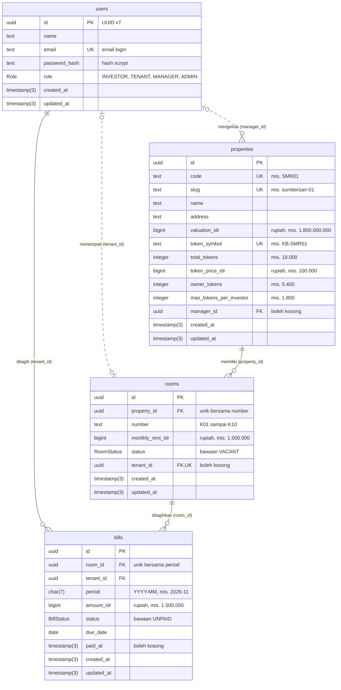
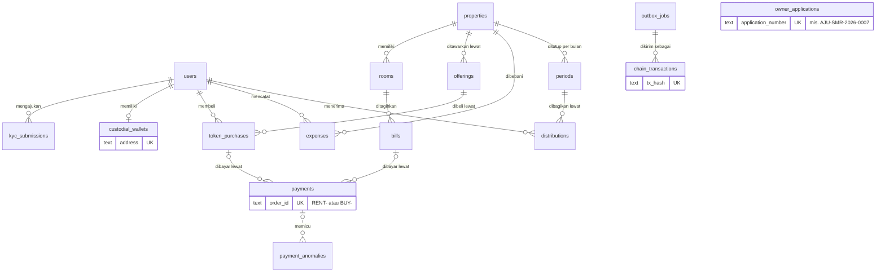

# ERD KosBagi

Diagram entitas dan relasi (ERD) basis data KosBagi. ERD ini disusun dari [`backend/prisma/schema.prisma`](../../backend/prisma/schema.prisma) dan migrasi [`20261029120000_init`](../../backend/prisma/migrations/20261029120000_init/migration.sql). Bila ada perbedaan, skema Prisma yang menjadi acuan dan ERD ini disesuaikan.

Status: skema v1 (P1, 29 Okt 2026) dengan empat tabel: `users`, `properties`, `rooms`, dan `bills`. Tabel lain masih berupa rencana dan dipisahkan di bagian [Rencana entitas P2 sampai P4](#rencana-entitas-p2-sampai-p4).

## Cara membaca

Setiap kotak adalah satu tabel PostgreSQL. Setiap baris di dalam kotak berisi tipe kolom, nama kolom, kunci, dan keterangan singkat.

| Kunci | Arti |
|---|---|
| `PK` | Primary key, pengenal unik setiap baris |
| `FK` | Foreign key, merujuk ke primary key tabel lain |
| `UK` | Unique key, nilainya tidak boleh kembar di seluruh tabel |

Ujung garis memakai notasi crow's foot. Simbol yang menempel pada sebuah tabel menyatakan berapa baris tabel itu yang bisa terhubung dengan satu baris di ujung lainnya.

| Simbol di ujung garis | Arti |
|---|---|
| Dua garis tegak | Tepat satu |
| Lingkaran dan satu garis tegak | Nol atau satu |
| Lingkaran dan kaki gagak | Nol atau banyak |
| Satu garis tegak dan kaki gagak | Satu atau banyak |

Garis penuh berarti kolom foreign key wajib diisi, sehingga baris anak tidak bisa ada tanpa induknya. Garis putus-putus berarti foreign key boleh kosong.

Nama model di kode memakai camelCase, sedangkan nama tabel dan kolom di PostgreSQL memakai snake_case (lewat `@@map` dan `@map`):

| Model Prisma | Tabel | Contoh field dan kolom |
|---|---|---|
| `User` | `users` | `passwordHash` menjadi `password_hash` |
| `Property` | `properties` | `valuationIdr` menjadi `valuation_idr` |
| `Room` | `rooms` | `monthlyRentIdr` menjadi `monthly_rent_idr` |
| `Bill` | `bills` | `amountIdr` menjadi `amount_idr` |

## Diagram ERD v1 (P1)

Semua kolom wajib diisi kecuali yang bertanda "boleh kosong": `properties.manager_id`, `rooms.tenant_id`, dan `bills.paid_at`.

## Entitas dan kolom penting

### `users` (model `User`)

Akun pengguna aplikasi untuk keempat peran. Semua akun di prototipe adalah data dummy. Data pribadi hanya disimpan di tabel ini dan tidak pernah dikirim ke blockchain.

| Kolom | Tipe | Keterangan |
|---|---|---|
| `id` | `uuid` | Primary key, UUID v7 yang dibuat Prisma saat baris disimpan |
| `name` | `text` | Nama tampilan, mis. Sari Wulandari |
| `email` | `text` | Unik, dipakai untuk masuk. Akun dummy memakai domain `kosbagi.test` |
| `password_hash` | `text` | Hash scrypt dari kata sandi, bukan kata sandinya |
| `role` | `Role` | Peran: menentukan menu yang tampil dan endpoint yang boleh dipanggil |
| `created_at`, `updated_at` | `timestamp(3)` | Waktu dibuat dan terakhir diubah |

### `properties` (model `Property`)

Kos yang ditokenisasi. Di prototipe hanya ada satu baris: Kos Sumbersari 01.

| Kolom | Tipe | Keterangan |
|---|---|---|
| `code` | `text` | Unik. Kode singkat yang dipakai di `order_id` dan data on-chain, mis. `SMR01` |
| `slug` | `text` | Unik. Penanda URL halaman publik, mis. `sumbersari-01` untuk `/kos/sumbersari-01` |
| `valuation_idr` | `bigint` | Nilai properti hasil penilaian dalam rupiah, mis. 1.800.000.000 |
| `token_symbol` | `text` | Unik. Simbol token ERC-20 properti ini, mis. `KB-SMR01` |
| `total_tokens` | `integer` | Seluruh token yang diterbitkan, mis. 18.000 |
| `token_price_idr` | `bigint` | Harga satu token dalam rupiah, mis. 100.000 |
| `owner_tokens` | `integer` | Token yang tetap dipegang pemilik lama, mis. 5.400 (30%); sisanya dijual ke investor |
| `max_tokens_per_investor` | `integer` | Batas kepemilikan per investor, mis. 1.800 (10%); juga ditegakkan di kontrak `KosToken` |
| `manager_id` | `uuid` | Pengguna berperan MANAGER yang mengelola properti ini. Boleh kosong |

### `rooms` (model `Room`)

Kamar di sebuah properti, mis. K03 di Kos Sumbersari 01.

| Kolom | Tipe | Keterangan |
|---|---|---|
| `property_id` | `uuid` | Properti pemilik kamar. Wajib |
| `number` | `text` | Nomor kamar K01 sampai K10, unik dalam satu properti |
| `monthly_rent_idr` | `bigint` | Sewa per bulan dalam rupiah, mis. 1.500.000 |
| `status` | `RoomStatus` | Status hunian, bawaan `VACANT` |
| `tenant_id` | `uuid` | Penghuni saat ini. Boleh kosong dan unik, sehingga satu penghuni hanya menempati satu kamar |

### `bills` (model `Bill`)

Tagihan sewa satu kamar untuk satu periode bulan.

| Kolom | Tipe | Keterangan |
|---|---|---|
| `room_id` | `uuid` | Kamar yang ditagih. Wajib |
| `tenant_id` | `uuid` | Penghuni yang ditagih, dicatat saat tagihan dibuat. Wajib |
| `period` | `char(7)` | Periode sewa berformat `YYYY-MM`, mis. `2026-11` |
| `amount_idr` | `bigint` | Nominal tagihan dalam rupiah. Webhook menolak pembayaran yang nominalnya berbeda |
| `status` | `BillStatus` | Bawaan `UNPAID`; menjadi `PAID` hanya lewat webhook Midtrans yang terverifikasi |
| `due_date` | `date` | Tanggal jatuh tempo, tanpa jam, mis. 10 Nov 2026 |
| `paid_at` | `timestamp(3)` | Waktu tagihan menjadi lunas. Kosong selama belum dibayar |

## Relasi

| Relasi | Kardinalitas | Foreign key | Bila induk dihapus | Arti |
|---|---|---|---|---|
| `properties` ke `rooms` | Satu properti punya nol atau banyak kamar; setiap kamar tepat satu properti | `rooms.property_id` | Ditolak (RESTRICT) | Properti yang masih punya kamar tidak bisa dihapus |
| `rooms` ke `bills` | Satu kamar punya nol atau banyak tagihan, paling banyak satu per periode | `bills.room_id` | Ditolak (RESTRICT) | Tagihan adalah catatan keuangan, jadi kamarnya tidak boleh hilang |
| `users` ke `bills` | Satu penghuni punya nol atau banyak tagihan; setiap tagihan tepat satu penghuni | `bills.tenant_id` | Ditolak (RESTRICT) | Riwayat siapa yang ditagih tetap terjaga |
| `users` ke `rooms` | Satu pengguna menempati nol atau satu kamar; satu kamar ditempati nol atau satu penghuni | `rooms.tenant_id` (unik) | Dikosongkan (SET NULL) | Kamar menjadi kosong bila akun penghuni dihapus |
| `users` ke `properties` | Satu pengelola mengelola nol atau banyak properti; satu properti punya nol atau satu pengelola | `properties.manager_id` | Dikosongkan (SET NULL) | Properti tetap ada walau pengelolanya dihapus |

Semua foreign key memakai `ON UPDATE CASCADE`. Karena primary key berupa UUID yang tidak pernah berubah, aturan ini praktis tidak pernah terpakai.

**Kenapa `bills.tenant_id` ada padahal `rooms.tenant_id` sudah ada?** Keduanya bermakna berbeda. `rooms.tenant_id` adalah penghuni saat ini dan bisa berganti. `bills.tenant_id` adalah penghuni yang ditagih pada periode itu dan tidak berubah setelah tagihan dibuat. Bila Sari pindah kamar atau keluar, tagihan November 2026 tetap tercatat atas nama Sari.

## Constraint unik dan indeks

| Nama di PostgreSQL | Kolom | Jenis | Gunanya |
|---|---|---|---|
| `users_email_key` | `users.email` | Unik | Satu email untuk satu akun |
| `properties_code_key` | `properties.code` | Unik | Kode `SMR01` di `order_id` dan data on-chain tidak boleh kembar |
| `properties_slug_key` | `properties.slug` | Unik | Satu URL untuk satu kos |
| `properties_token_symbol_key` | `properties.token_symbol` | Unik | Satu simbol token untuk satu properti |
| `rooms_property_id_number_key` | `rooms.property_id`, `rooms.number` | Unik gabungan | Nomor kamar tidak kembar dalam satu properti |
| `rooms_tenant_id_key` | `rooms.tenant_id` | Unik | Satu penghuni hanya menempati satu kamar |
| `bills_room_id_period_key` | `bills.room_id`, `bills.period` | Unik gabungan | Satu tagihan per kamar per periode, jadi kamar tidak bisa ditagih dua kali dalam sebulan |
| `properties_manager_id_idx` | `properties.manager_id` | Indeks | Mempercepat daftar properti milik satu pengelola |
| `bills_tenant_id_idx` | `bills.tenant_id` | Indeks | Mempercepat halaman Tagihan penghuni |
| `bills_period_status_idx` | `bills.period`, `bills.status` | Indeks gabungan | Mempercepat papan kamar dan rekap tagihan lunas per bulan |

Constraint unik gabungan pada `bills` juga menjamin bahwa kombinasi kode properti, nomor kamar, dan periode tidak kembar. Kombinasi itulah yang membentuk `order_id`, mis. `RENT-SMR01-K03-2026-11` dari `properties.code` = `SMR01`, `rooms.number` = `K03`, dan `bills.period` = `2026-11`.

## Enum

**`Role`**: peran pengguna.

| Nilai | Arti | Rute halaman |
|---|---|---|
| `INVESTOR` | Investor pembeli token | `/investor` |
| `TENANT` | Penghuni kos | `/penghuni` |
| `MANAGER` | Pengelola kos | `/pengelola` |
| `ADMIN` | Admin platform | `/admin` |

**`RoomStatus`**: status hunian kamar.

| Nilai | Arti |
|---|---|
| `OCCUPIED` | Terisi. Contoh: 9 dari 10 kamar Kos Sumbersari 01 terisi (okupansi 90%) |
| `VACANT` | Kosong. Nilai bawaan untuk kamar baru |
| `MAINTENANCE` | Dalam perbaikan, tidak disewakan |

**`BillStatus`**: status tagihan sewa.

| Nilai | Arti | Label di layar |
|---|---|---|
| `UNPAID` | Belum dibayar. Nilai bawaan | Belum dibayar. Label Menunggu pembayaran, Kedaluwarsa, dan Gagal berasal dari percobaan pembayaran terakhir (tabel pembayaran, P2) |
| `PAID` | Lunas. Hanya diubah oleh webhook Midtrans yang terverifikasi | Lunas |

Pembayaran yang gagal, batal, atau kedaluwarsa tidak pernah mengubah status tagihan. Hubungannya dengan status di antarmuka digambarkan di [arsitektur bagian 6](arsitektur.md#6-status-yang-tampil-di-layar).

## Keputusan tipe data

**Uang disimpan sebagai rupiah bilangan bulat (`bigint`).** Semua kolom berakhiran `_idr` berisi rupiah utuh tanpa pecahan:

- Rupiah dalam transaksi tidak memakai pecahan sen, jadi bilangan bulat sudah cukup.
- Tipe pecahan biner (float atau double) tidak bisa menyimpan sebagian angka desimal dengan tepat, sehingga jumlah banyak transaksi bisa meleset. Bilangan bulat selalu tepat, jadi total di rekonsiliasi bisa dicocokkan sama persis dengan Midtrans dan blockchain.
- `bigint` (64 bit, batas sekitar 9,2 × 1018) dipilih, bukan `integer` (32 bit, batas 2.147.483.647, sekitar Rp2,1 miliar). Nilai properti Rp1.800.000.000 sudah dekat dengan batas `integer`, dan total beberapa properti atau beberapa tahun akan melewatinya.
- Smart contract juga memakai bilangan bulat, jadi nominal bisa dikirim ke blockchain tanpa konversi dan tanpa pembulatan.
- Di kode backend nilai ini bertipe `bigint` JavaScript. API mengirimnya sebagai angka JSON biasa, mis. `1500000`, karena masih jauh di bawah batas aman angka JavaScript (253 − 1).

**Jumlah token disimpan sebagai `integer`.** Token tidak bisa dipecah (satu token mewakili Rp100.000), dan 18.000 token jauh di bawah batas `integer`.

**ID memakai UUID v7.** UUID v7 acak sehingga tidak bisa ditebak dari URL, tetapi diawali stempel waktu sehingga terurut menurut waktu pembuatan dan ramah indeks. Nilainya dibuat Prisma di aplikasi saat baris disimpan, bukan oleh default basis data.

**Periode disimpan sebagai `char(7)` berformat `YYYY-MM`.** Formatnya sama dengan bagian periode di `order_id` dan data on-chain, dan urutan teksnya sama dengan urutan waktu.

**Waktu disimpan sebagai `timestamp(3)`.** Presisinya milidetik. `created_at` diisi basis data saat baris dibuat, sedangkan `updated_at` diisi Prisma saat baris dibuat dan setiap kali baris diubah. `due_date` memakai `date` karena jatuh tempo tidak butuh jam.

## Rencana entitas P2 sampai P4

> [!IMPORTANT]
> Bagian ini **rencana**, bukan skema yang sedang berjalan. Skema berjalan di P1 hanya berisi empat tabel di atas. Nama tabel di bawah masih sementara; nama, kolom, dan relasi finalnya ditetapkan jalur 2 di migrasi skema v2 (P2) dan P4, lalu ERD ini diperbarui.

Diagram rencana hanya memuat nama entitas, relasi, dan kunci yang sudah ditentukan di rencana kerja. Empat tabel P1 (`users`, `properties`, `rooms`, `bills`) ikut digambar untuk menunjukkan tempat entitas baru menempel.

| Entitas (nama sementara) | Isi utama | Relasi | Progress | Kaitan |
|---|---|---|---|---|
| `kyc_submissions` | Data KYC dummy, status (belum mengajukan, diajukan, disetujui, ditolak), alasan penolakan, peninjau | Satu investor bisa mengajukan lebih dari sekali bila ditolak | P2 (API), P3 (whitelist on-chain) | Demo D1, US-INV-01, US-ADM-01 |
| `custodial_wallets` | Alamat dompet kustodian investor dan indeks turunannya | Satu investor punya nol atau satu dompet | P2 (skema), P3 (dipakai) | Keputusan K5 di arsitektur |
| `payments` | Satu percobaan pembayaran Midtrans: `order_id` unik berawalan `RENT-` atau `BUY-`, nominal, status dari Midtrans, metode, batas waktu | Terhubung ke salah satu: tagihan atau pembelian token. Satu tagihan bisa punya beberapa percobaan | P2 | Skenario S1 sampai S5, lapis pertama anti transaksi ganda |
| `payment_anomalies` | Notifikasi yang ditolak, mis. nominal tidak cocok, beserta nominal yang diharapkan dan yang diterima | Merujuk pembayaran bila ada | P2 | Skenario S7, demo D6 |
| `outbox_jobs` | Job blockchain yang ditulis dalam transaksi basis data yang sama dengan perubahan status: whitelist KYC, `recordRent`, transfer token, `recordExpense`, `closePeriod` | Sumber job (pembayaran, KYC, biaya, periode) dirujuk lewat isi job | P2 | Keputusan K2 di arsitektur |
| `chain_transactions` | Transaksi Sepolia: referensi, tx hash unik, nomor blok, status (menunggu, tercatat, gagal), jumlah percobaan | Satu job bisa menghasilkan lebih dari satu percobaan transaksi | P2 (skema), P3 (dipakai) | Status on-chain dan tautan Etherscan di layar |
| `offerings` | Penawaran token satu properti: 12.600 token, jumlah terjual, tanggal tutup 31 Des 2026 | Satu properti punya nol atau banyak penawaran | P2 (skema), P3 | US-INV-02, skenario S8 |
| `token_purchases` | Pesanan investor: jumlah token, nominal, status | Satu penawaran dan satu investor punya banyak pembelian | P2 (skema), P3 | Demo D1, skenario S8 dan S9 |
| `owner_applications` | Pengajuan pemilik kos: nomor seperti `AJU-SMR-2026-0007`, data dummy, status lima tahap | Berdiri sendiri karena pemilik kos tidak punya akun | P2 | US-PML-04 |
| `expenses` | Biaya operasional: kategori, tanggal, nominal, lokasi berkas nota, hash nota | Satu properti punya banyak biaya, dicatat pengelola | P4 | Demo D3, US-PGL-02 |
| `periods` | Penutupan periode: sewa kotor, biaya, fee pengelolaan 5%, pajak, sewa bersih, nilai per token, blok penutupan | Satu baris per properti per bulan | P4 | Demo D4, skenario S12 |
| `distributions` | Bagian setiap investor dalam satu periode: saldo token pada blok penutupan × nilai per token | Satu baris per periode per investor | P4 | Demo D4 dan D5 |

Saldo bagi hasil investor direncanakan sebagai jumlah semua distribusinya, dikurangi penarikan bila fitur penarikan (opsional, P5) dibangun.
