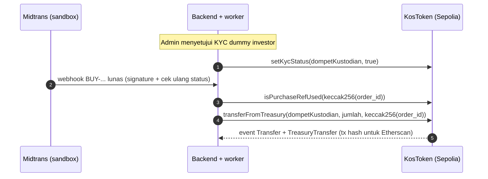

# Rancangan Smart Contract KosBagi

Dokumen ini menjelaskan rancangan tiga smart contract KosBagi di Ethereum Sepolia: `KosToken` (selesai di progress 1), `KosLedger` (selesai di progress 2), dan `KosVoting` (opsional, rencana progress 4). Kode ada di [`contracts/contracts/`](../../contracts/contracts/), test di [`contracts/test/`](../../contracts/test/), laporan uji di [`docs/pengujian/kontrak.md`](../pengujian/kontrak.md).

| Kontrak | Fungsi utama | Progress | Status |
|---|---|---|---|
| `KosToken` | Token hak manfaat ekonomi satu properti (KB-SMR01): KYC, batas 10%, jeda darurat, delegasi otomatis, registri dokumen | P1 | Selesai, 63 test lulus, cakupan baris 100% |
| `KosLedger` | `recordRent`, `recordExpense`, `closePeriod`, `shareOf`: buku besar sewa dan biaya per periode, angka distribusi final | P2 | Selesai, 65 test lulus, cakupan baris 100% |
| `KosVoting` | `propose`, `vote`, `tally` | P4 (opsional) | Rencana (bagian 5) |

## 1. Posisi kontrak dalam arsitektur

Investor dan penghuni tidak pernah mengirim transaksi blockchain sendiri. Backend menerima webhook Midtrans, memverifikasinya, lalu menaruh job di antrean. Worker yang memegang **dompet operator** (satu-satunya dompet berisi ETH Sepolia) memanggil kontrak. Setiap investor punya **dompet kustodian** sendiri yang diturunkan dari mnemonic HD di backend dan tidak pernah diisi ETH.



## 2. Prinsip yang berlaku untuk semua kontrak

1. **Fungsi tulis hanya untuk pemegang peran.** Kontrol akses memakai `AccessControl` OpenZeppelin. Dompet operator memegang peran operasional; dompet admin memberi dan mencabut peran, mencatat dokumen properti, dan ikut memegang jeda darurat.
2. **Tanpa data pribadi on-chain.**

   | Boleh on-chain | Tidak boleh on-chain |
   |---|---|
   | Kode properti (`SMR01`), nomor kamar, periode, nominal Rupiah atau jumlah token | Nama investor atau penghuni |
   | Alamat dompet kustodian (pseudonim, tidak terhubung ke identitas di chain) | NIK/KTP, nomor rekening, email, nomor HP |
   | `keccak256(order_id)` sebagai referensi pembayaran | `order_id` mentah bila memuat data pribadi |
   | Hash dokumen (sertifikat, laporan penilaian, perjanjian pengelolaan, nota) | Isi dokumen |

   Catatan untuk backend: `order_id` sebaiknya hanya berisi kode properti, kamar, periode, atau nomor urut (mis. `RENT-SMR01-K03-2026-11`, `BUY-SMR01-000123`). Hash dari teks yang mudah ditebak bisa dicocokkan ulang, jadi jangan masukkan data pribadi ke `order_id`.
3. **Custom error** dipakai untuk semua penolakan (lebih hemat gas daripada teks `require` dan bisa dibaca backend lewat ABI).
4. **Versi dipin:** Solidity `0.8.34` (pragma persis, tanpa `^`), OpenZeppelin Contracts `5.6.1`, target EVM `osaka`. Alasan pemilihan compiler ada di bagian 3.11.
5. **Basis poin (bp)** untuk semua persentase: 10.000 bp = 100%, 1.000 bp = 10%, 500 bp = 5%.
6. **Tidak upgradeable.** Kontrak di-deploy apa adanya tanpa proxy. Perubahan aturan berarti deploy kontrak baru. Ini lebih sederhana dan lebih mudah diaudit untuk prototipe.

## 3. KosToken

### 3.1 Parameter penerbitan KB-SMR01

| Data | Nilai | Sumber di kontrak |
|---|---|---|
| Kode properti | `SMR01` | `propertyCode()` |
| Nama / simbol | `KosBagi SMR01` / `KB-SMR01` | dibentuk otomatis dari kode properti |
| Decimals | 0 (1 token = Rp100.000, tidak bisa dipecah) | `decimals()` |
| Total suplai | 18.000 token (Rp1,8 miliar) | `totalSupply()` |
| Dompet pemilik lama | 5.400 token (30%) | `originalOwner()` |
| Dompet perbendaharaan properti | 12.600 token (70%, dijual ke investor) | `treasury()` |
| Batas saldo per alamat | 1.800 token (10% suplai) | `maxBalance()`, `MAX_BALANCE_BPS = 1000` |
| Sertifikat | SHA-256 isi file PDF sertifikat, versi 1 dicatat saat deploy | `currentDocumentHash(DOCUMENT_CERTIFICATE)` |
| Laporan penilaian | SHA-256 isi file PDF laporan penilaian, versi 1 dicatat saat deploy | `currentDocumentHash(DOCUMENT_APPRAISAL_REPORT)` |
| Perjanjian pengelolaan | SHA-256 isi file PDF, dicatat admin setelah deploy | `currentDocumentHash(DOCUMENT_MANAGEMENT_AGREEMENT)` |

Kontrak bersifat umum: properti lain cukup di-deploy ulang dengan kode properti, alamat, jatah, dan hash dokumennya sendiri. Batas 10% dihitung dari total suplai saat deploy.

Konstruktor:

```solidity
constructor(
    string memory propertyCode_,      // "SMR01"
    bytes32 certificateHash,          // versi 1 DOCUMENT_CERTIFICATE
    bytes32 appraisalReportHash,      // versi 1 DOCUMENT_APPRAISAL_REPORT
    address admin,                    // pemegang DEFAULT_ADMIN_ROLE dan PAUSER_ROLE
    address operator,                 // mendapat OPERATOR_ROLE, KYC_ROLE, PAUSER_ROLE
    address originalOwner_,
    address treasury_,
    uint256 originalOwnerAllocation,  // 5400
    uint256 treasuryAllocation        // 12600
)
```

Secara teknis `admin` dan `operator` boleh alamat yang sama, tetapi **deploy Sepolia di P3 sebaiknya memakai dompet admin yang terpisah dari dompet operator** (mis. dompet MetaMask milik koordinator dengan sedikit ETH Sepolia). Konstruktor hanya butuh *alamat* admin, jadi deploy tetap bisa dikirim dompet operator tanpa memakai kunci admin. Bila keduanya satu dompet, kunci operator yang bocor otomatis juga menguasai semua peran admin dan prosedur darurat di bagian 3.13 tidak bisa dijalankan.

Sesudah deploy, admin memanggil `anchorDocument(DOCUMENT_MANAGEMENT_AGREEMENT, hash)` sehingga tab Dokumen di halaman properti langsung menampilkan tiga dokumen berstatus on-chain. Cara admin menandatangani transaksi (mis. MetaMask lewat tab Write Contract di Etherscan, atau skrip dengan kunci admin terpisah) diputuskan di P3.

### 3.2 Pewarisan dari OpenZeppelin

| Komponen | Yang diberikan |
|---|---|
| `ERC20` | Saldo, transfer, allowance, event `Transfer`/`Approval` |
| `ERC20Pausable` (+ `Pausable`) | Semua perpindahan saldo gagal saat kontrak dijeda |
| `AccessControl` | Peran berbasis `bytes32`, modifier `onlyRole`, `grantRole`/`revokeRole` |
| `ERC20Permit` | `permit()` (ERC-2612): izin allowance lewat tanda tangan, tanpa gas dari pemilik token |
| `ERC20Votes` | Checkpoint bobot suara per blok, `getVotes`, `getPastVotes`, `getPastTotalSupply` |

Semua komponen di-import dari paket npm, tidak disalin. Aturan tambahan KosBagi dipasang di satu titik, yaitu override `_update` (titik kustomisasi resmi ERC-20 OpenZeppelin 5).

### 3.3 Peran

| Peran | Pemegang saat deploy | Fungsi |
|---|---|---|
| `DEFAULT_ADMIN_ROLE` | `admin` | `grantRole`, `revokeRole` untuk semua peran; `anchorDocument` |
| `OPERATOR_ROLE` | `operator` | `transferFromTreasury` |
| `KYC_ROLE` | `operator` | `setKycStatus` |
| `PAUSER_ROLE` | `operator` dan `admin` | `pause`, `unpause` |

Admin tidak diberi peran operasional harian (`OPERATOR_ROLE`, `KYC_ROLE`), tetapi ikut memegang `PAUSER_ROLE` supaya bisa menjeda sendiri saat darurat tanpa bergantung pada dompet operator. Operator tidak bisa memberi peran ke siapa pun maupun mengganti dokumen (diuji).

### 3.4 Fungsi

Fungsi tulis:

| Fungsi | Pemanggil | Keterangan | Error khusus |
|---|---|---|---|
| `setKycStatus(account, approved)` | `KYC_ROLE` | Meloloskan atau mencabut KYC. Idempoten (aman diulang) | `ZeroAddress` |
| `transferFromTreasury(to, amount, purchaseRef)` | `OPERATOR_ROLE` | Memindahkan token dari perbendaharaan ke dompet kustodian setelah pembelian lunas; `purchaseRef` hanya bisa dipakai sekali | `ZeroAmount`, `EmptyPurchaseRef`, `PurchaseRefAlreadyUsed` |
| `anchorDocument(documentType, documentHash)` | `DEFAULT_ADMIN_ROLE` | Mencatat hash dokumen sebagai versi baru di registri (lihat 3.6) | `EmptyDocumentType`, `EmptyDocumentHash`, `DocumentAlreadyAnchored` |
| `pause()` / `unpause()` | `PAUSER_ROLE` | Jeda darurat semua perpindahan token | (bawaan) `EnforcedPause`, `ExpectedPause` |
| `grantRole` / `revokeRole` / `renounceRole` | admin peran / diri sendiri | Bawaan `AccessControl` | (bawaan) |
| `transfer`, `approve`, `transferFrom`, `permit` | pemegang token | Fungsi standar ERC-20/ERC-2612. Tetap tunduk pada aturan `_update` | lihat 3.5 |
| `delegate`, `delegateBySig` | siapa pun | **Dimatikan**, selalu gagal | `DelegationDisabled` |

Fungsi baca yang dipakai backend dan frontend: `isKycApproved(account)`, `isPurchaseRefUsed(purchaseRef)`, `balanceOf`, `totalSupply`, `maxBalance`, `originalOwner`, `treasury`, `propertyCode`, `currentDocumentHash(documentType)`, `documentHistory(documentType)`, konstanta `DOCUMENT_*`, `getVotes`, `getPastVotes(account, blok)`, `getPastTotalSupply(blok)`, `delegates`, `nonces`, `paused`, `hasRole`.

### 3.5 Aturan di `_update`

`_update(from, to, value)` adalah satu-satunya jalur perubahan saldo, jadi aturan berlaku sama untuk `transfer`, `transferFrom`, `transferFromTreasury`, dan mint saat deploy. Urutannya:

1. **KYC penerima.** Bila `to` belum lolos KYC, gagal dengan `RecipientNotKycApproved(to)`. Pengirim tidak dicek, sehingga pemegang yang KYC-nya dicabut tetap bisa mengembalikan token.
2. **Delegasi otomatis.** Bila `to` belum punya delegasi, kontrak menjalankan `_delegate(to, to)`. Ini terjadi sekali, saat alamat pertama kali menerima token, tanpa transaksi dari dompet kustodian.
3. **Perpindahan saldo** lewat `super._update`: cek jeda (`EnforcedPause`), cek saldo pengirim, update saldo, checkpoint bobot suara.
4. **Batas 10%.** Bila `to` bukan pemilik lama atau perbendaharaan dan saldo barunya lebih dari `maxBalance`, gagal dengan `BalanceCapExceeded(to, saldoBaru, maxBalance)`. Pengecekan memakai saldo setelah perpindahan, jadi transfer ke diri sendiri tidak terhitung ganda.

Karena transaksi Ethereum bersifat atomik, kegagalan di langkah mana pun membatalkan seluruh transaksi, termasuk penandaan `purchaseRef`.

### 3.6 Registri dokumen

Kontrak menyimpan hash dokumen properti per **jenis dokumen**, bukan sebagai kolom tetap, karena tab Dokumen di desain menampilkan beberapa dokumen berstatus on-chain dan jumlahnya bisa bertambah.

| Konstanta | Nilai | Kapan dicatat |
|---|---|---|
| `DOCUMENT_CERTIFICATE` | `keccak256("DOCUMENT_CERTIFICATE")` | Wajib, saat deploy |
| `DOCUMENT_APPRAISAL_REPORT` | `keccak256("DOCUMENT_APPRAISAL_REPORT")` | Wajib, saat deploy; diperbarui bila ada penilaian ulang (mis. tahunan) |
| `DOCUMENT_MANAGEMENT_AGREEMENT` | `keccak256("DOCUMENT_MANAGEMENT_AGREEMENT")` | Lewat `anchorDocument` sesudah deploy |

Jenis lain boleh dipakai tanpa mengubah kontrak dengan pola nama yang sama, mis. `keccak256("DOCUMENT_BUILDING_PERMIT")`. Daftar jenis yang dipakai dicatat di backend.

Aturan registri:

1. **Hash boleh diganti, riwayat tidak pernah hilang.** Laporan penilaian wajar diperbarui (penilaian ulang tahunan), dan dokumen lain bisa direvisi lewat adendum. Setiap pencatatan menambah versi baru di array `documentHistory(jenis)`; versi lama tidak dihapus atau ditimpa. `currentDocumentHash(jenis)` mengembalikan versi terakhir.
2. **Bisa diaudit dari dua sumber.** State kontrak (`documentHistory`) memberi semua versi tanpa perlu membaca log. Event `DocumentAnchored(documentType, documentHash, previousHash, version)` memberi waktu (blok) dan transaksi setiap pergantian, dan `previousHash` membuat rantai versi bisa ditelusuri dari log saja.
3. **Hanya admin.** Pergantian dokumen adalah keputusan tata kelola yang jarang, bukan operasi harian, jadi memakai `DEFAULT_ADMIN_ROLE`, bukan `OPERATOR_ROLE`. Selama admin dan operator memakai dompet berbeda, kunci operator yang bocor tidak bisa mengganti dokumen.
4. **Hash yang sama dengan versi berlaku ditolak** (`DocumentAlreadyAnchored`) supaya tidak ada versi ganda. Bila admin perlu kembali ke dokumen lama, hash lama dicatat ulang sebagai versi baru sehingga kejadiannya tetap terekam.
5. **Tetap bisa dipakai saat jeda**, sama seperti KYC dan pengaturan peran.
6. Sertifikat dan laporan penilaian versi 1 dicatat di konstruktor lewat fungsi internal yang sama dengan `anchorDocument`, jadi tidak ada jalur pencatatan kedua.

Alternatif yang ditolak: hash immutable tanpa bisa diganti (laporan penilaian tahunan tidak bisa dicatat dan setiap revisi berarti deploy token baru), dan hanya menyimpan hash terakhir dengan riwayat di event saja (riwayat jadi bergantung pada indeks log RPC, padahal biaya menyimpan beberapa hash tambahan kecil, sekitar 57.000 sampai 71.000 gas per pencatatan).

### 3.7 Event

| Event | Kapan | Isi |
|---|---|---|
| `TokenIssued(code, ownerWallet, treasuryWallet, supply)` | Sekali saat deploy | Bukti penerbitan |
| `DocumentAnchored(documentType, documentHash, previousHash, version)` | Deploy (sertifikat, laporan penilaian) dan `anchorDocument` | Riwayat versi setiap dokumen |
| `KycStatusUpdated(account, approved)` | Deploy (pemilik lama, perbendaharaan) dan `setKycStatus` | Riwayat KYC per alamat |
| `TreasuryTransfer(purchaseRef, to, amount)` | `transferFromTreasury` | Menghubungkan transfer on-chain dengan `order_id` pembelian |
| `Transfer`, `Approval` | Bawaan ERC-20 | |
| `DelegateChanged`, `DelegateVotesChanged` | Bawaan ERC20Votes (delegasi otomatis, perubahan saldo) | |
| `Paused`, `Unpaused` | Bawaan Pausable | |
| `RoleGranted`, `RoleRevoked` | Bawaan AccessControl | |

### 3.8 Daftar error

Error milik KosToken:

| Error | Penyebab |
|---|---|
| `ZeroAddress()` | Alamat nol untuk admin, operator, pemilik lama, perbendaharaan, atau akun KYC |
| `EmptyPropertyCode()` | Kode properti kosong saat deploy |
| `EmptyDocumentType()` | Jenis dokumen bernilai nol di `anchorDocument` |
| `EmptyDocumentHash()` | Hash dokumen bernilai nol (saat deploy atau di `anchorDocument`) |
| `DocumentAlreadyAnchored(documentType, documentHash)` | Hash sama dengan versi berlaku jenis dokumen itu |
| `SameOwnerAndTreasury()` | Dompet pemilik lama sama dengan perbendaharaan |
| `SupplyTooSmall()` | Total suplai di bawah 10 token sehingga batas 10% bernilai nol |
| `RecipientNotKycApproved(recipient)` | Penerima belum lolos KYC |
| `BalanceCapExceeded(recipient, newBalance, cap)` | Saldo penerima akan melebihi 1.800 token (skenario uji 10) |
| `ZeroAmount()` | `transferFromTreasury` dengan jumlah 0 |
| `EmptyPurchaseRef()` | `transferFromTreasury` dengan referensi nol |
| `PurchaseRefAlreadyUsed(purchaseRef)` | Referensi pembelian sudah pernah dipakai |
| `DelegationDisabled()` | Memanggil `delegate` atau `delegateBySig` |

Error bawaan OpenZeppelin yang mungkin muncul: `AccessControlUnauthorizedAccount(account, neededRole)`, `AccessControlBadConfirmation()` (`renounceRole` untuk alamat lain), `EnforcedPause()`, `ExpectedPause()`, `ERC20InsufficientBalance(sender, balance, needed)`, `ERC20InvalidReceiver(receiver)`, `ERC20InsufficientAllowance(spender, allowance, needed)`, `ERC2612ExpiredSignature(deadline)`, `ERC2612InvalidSigner(signer, owner)`, `ERC5805FutureLookup(timepoint, clock)`.

### 3.9 Keputusan desain

1. **Token keluar dari perbendaharaan lewat `transferFromTreasury` milik `OPERATOR_ROLE`.** Dompet kustodian dan perbendaharaan tidak punya ETH, dan dompet operator yang mengirim semua transaksi harian. Alternatif yang ditolak:
   - *`approve` dari perbendaharaan ke operator, lalu `transferFrom`*: perbendaharaan harus menandatangani dan membayar gas, kunci perbendaharaan harus dipakai rutin, dan allowance besar berbahaya bila kunci operator bocor tanpa batasan aturan tambahan.
   - *Perbendaharaan = alamat kontrak itu sendiri*: tidak ada kunci perbendaharaan sama sekali, tetapi token yang salah kirim ke kontrak akan tercampur dengan stok penawaran dan alur "dompet perbendaharaan PT KosBagi Properti" di proposal jadi kabur.

   Dengan fungsi khusus, kewenangan operator dibatasi: hanya bisa memindahkan saldo **dari alamat perbendaharaan**, tidak dari dompet lain, dan tetap tunduk pada KYC, batas 10%, dan jeda. Perbendaharaan tetap alamat terpisah yang terlihat jelas di Etherscan.
2. **`purchaseRef` anti ganda.** Setiap pemindahan dari perbendaharaan membawa `keccak256(order_id)` pembelian `BUY-...` dan ditolak bila referensinya sudah dipakai. Ini lapisan ketiga pencegahan transaksi ganda untuk pembelian token (setelah constraint unik `order_id` di DB dan deduplikasi webhook), sama seperti `recordRent` di `KosLedger`. Bila transaksi gagal, referensi tidak tercatat sehingga job bisa diulang.
3. **Pemilik lama dan perbendaharaan otomatis lolos KYC saat deploy.** Keduanya diverifikasi off-chain saat onboarding properti. Dengan begitu aturan "penerima wajib lolos KYC" berlaku tanpa pengecualian, termasuk untuk mint.
4. **Pengecualian batas 10% bersifat `immutable`.** Hanya dua alamat yang ditetapkan saat deploy yang dikecualikan. Operator atau admin tidak bisa menambah alamat lain ke daftar pengecualian.
5. **Delegasi otomatis, delegasi manual dimatikan.** Di ERC20Votes, saldo baru dihitung sebagai bobot suara bila pemiliknya sudah mendelegasikan. Dompet kustodian tidak bisa mengirim transaksi `delegate` (tanpa ETH), jadi kontrak mendelegasikan ke diri sendiri saat alamat pertama kali menerima token. Delegasi ke pihak lain dimatikan supaya `getPastVotes(alamat, blok)` selalu sama dengan saldo di blok itu. Nilai inilah yang dipakai sebagai snapshot saldo untuk bagi hasil (`KosLedger.closePeriod`) dan bobot voting (`KosVoting`).
6. **Pencabutan KYC hanya menutup pintu masuk.** Alamat yang KYC-nya dicabut tidak bisa menerima token lagi, tetapi tetap bisa mengirim token keluar (mis. dikembalikan ke perbendaharaan), sehingga tidak ada token yang terkunci selamanya.
7. **Jeda hanya menghentikan perpindahan token.** `setKycStatus`, `anchorDocument`, dan pengaturan peran tetap berjalan saat jeda, supaya admin bisa membereskan masalah sebelum melanjutkan.
8. **`decimals() = 0`.** Satu token adalah satu unit utuh senilai Rp100.000, sama dengan satuan pembelian di proposal. Tidak ada pecahan token.
9. **Suplai tetap.** Tidak ada fungsi mint atau burn setelah deploy, jadi total 18.000 token tidak bisa diubah siapa pun.
10. **ERC20Permit untuk dompet tanpa ETH.** Bila token perlu ditarik dari dompet kustodian (mis. penawaran batal dan dana dikembalikan, rencana P3), backend menandatangani `permit` secara off-chain dengan kunci dompet kustodian, lalu operator mengirim `permit` dan `transferFrom` ke perbendaharaan. Dompet kustodian tetap tidak perlu ETH. Alur ini sudah diuji di test.
11. **Nama dan simbol dibentuk dari kode properti** (`KosBagi <kode>`, `KB-<kode>`), sehingga penamaan antarproperti konsisten dan parameter konstruktor lebih sedikit.
12. **Dokumen properti disimpan sebagai registri berversi**, bukan kolom hash tetap: jenis dokumen bisa bertambah, laporan penilaian bisa diperbarui, dan semua versi lama tetap tersimpan. Rinciannya di bagian 3.6.

### 3.10 Perkiraan gas (profil `production`, optimizer 200 runs)

| Operasi | Gas |
|---|---|
| Deploy KosToken (termasuk 2 dokumen versi 1) | ± 3.074.000 |
| `anchorDocument` (jenis dokumen baru, versi 1) | ± 71.000 |
| `anchorDocument` (versi pengganti) | ± 57.000 |
| `setKycStatus` (alamat baru) | ± 48.000 |
| `transferFromTreasury` (penerima pertama kali, termasuk delegasi otomatis) | ± 191.000 |
| `transferFromTreasury` (penerima yang sudah punya token) | ± 137.000 |
| `transfer` antarpemegang (penerima baru) | ± 164.000 |
| `pause` / `unpause` | ± 47.000 / 25.000 |

Dengan harga gas Sepolia 1 sampai 10 gwei, deploy menghabiskan sekitar 0,003 sampai 0,031 ETH Sepolia. Ukuran bytecode 10.805 byte (profil `production`) dan 19.852 byte (profil `default`), di bawah batas 24.576 byte.

### 3.11 Compiler, profil build, dan bug compiler yang diketahui

- **Profil `default`** (tanpa optimizer) dipakai `hardhat build` dan `hardhat test`. **Profil `production`** (optimizer 200 runs) dipakai Hardhat Ignition saat deploy dan `hardhat verify`. Karena bytecode yang di-deploy berasal dari profil `production`, test juga dijalankan pada profil itu (`npm run test:production`) dan hasilnya sama-sama lulus.
- **Kenapa 0.8.34, bukan versi terbaru 0.8.38?** Mulai 0.8.35 compiler memberi peringatan bahwa `at` dan `error` akan menjadi kata kunci. Kode OpenZeppelin 5.6.1 masih memakai kedua nama itu (9 peringatan), dan 5.7.0 (masih bertanda `dev` di npm) pun masih memakai `at`. 0.8.34 adalah versi terbaru yang mengompilasi tanpa warning, dan sama dengan versi di template resmi Hardhat 3.
- **Bug yang diketahui untuk 0.8.34** (daftar resmi `bugs_by_version.json` Solidity) sudah dicek terhadap proyek ini:

  | Bug | Syarat terjadinya | Status di KosBagi |
  |---|---|---|
  | `MisorderedNamedParametersInRequireWithCustomErrors`, `SpillSlotCollisionAcrossMutualRecursion`, `UnsoundSpillInMutualRecursion` | Hanya pipeline via-IR | Tidak berlaku, via-IR tidak dipakai |
  | `MemoryByteArrayElementDeleteClearsWholeWord` | `delete` pada elemen `bytes` di memory | Tidak berlaku, tidak ada perintah `delete` di 35 file yang dikompilasi |
  | `InheritanceOrderReversalOnStorageEndWarning` | Peringatan "storage end" muncul (layout storage kustom) | Tidak berlaku, tidak ada `layout at` dan kompilasi tanpa warning |
  | `YulOptimizerKnowledgeBaseStaleBookkeeping` (tingkat rendah) | Keluaran yang dioptimasi | Risiko kecil di profil `production`; dimitigasi dengan menjalankan seluruh test pada profil itu |

- **Target EVM `osaka`** ditulis eksplisit. Jaringan lokal Hardhat 3 memakai hard fork Osaka secara bawaan dan Sepolia sudah mengaktifkan Fusaka (Osaka) sejak Oktober 2025.

### 3.12 Checklist keamanan

| Butir | Status |
|---|---|
| Reentrancy | Tidak ada panggilan ke kontrak luar maupun pengiriman ETH. Tidak berlaku |
| Overflow/underflow | Aritmetika bawaan Solidity 0.8 selalu dicek; suplai juga dibatasi ERC20Votes (maks. 2^208 - 1) |
| Kontrol akses | Semua fungsi tulis berperan memakai `onlyRole`; setiap fungsi diuji menolak pemanggil tanpa peran |
| Validasi input | Alamat nol, jumlah nol, referensi nol, kode kosong, jenis dokumen nol, hash nol atau sama dengan versi berlaku, suplai terlalu kecil |
| Front-running | Pemindahan dari perbendaharaan hanya oleh operator dan dilindungi `purchaseRef`. Lihat catatan permit di bawah |
| Jeda darurat | `ERC20Pausable`, dikendalikan `PAUSER_ROLE` (operator dan admin); prosedur darurat di bagian 3.13 |
| `delegatecall`, `tx.origin`, `selfdestruct` | Tidak dipakai |
| Event | Setiap perubahan penting memancarkan event |
| Alamat hardcode | Tidak ada; semua alamat lewat konstruktor |
| Replay tanda tangan | `permit` memakai EIP-712 dengan `chainId`, alamat kontrak, nonce, dan tenggat (bawaan OpenZeppelin); `delegateBySig` dimatikan |
| Upgrade | Tidak upgradeable, tidak ada risiko tabrakan storage proxy |

Risiko yang disadari (diterima untuk prototipe):

- **Sentralisasi kunci operator.** Operator bisa menjeda, mengubah KYC, dan menyalurkan stok perbendaharaan. Dampaknya dibatasi dengan dompet admin terpisah dan prosedur darurat di bagian 3.13. Untuk produksi: admin dan operator memakai multisig, admin memakai `AccessControlDefaultAdminRules` atau timelock, dan kunci operator disimpan di KMS. Di prototipe kunci hanya ada di environment variable.
- **Permit bisa didahului orang lain.** Tanda tangan permit yang terlihat di mempool bisa dikirim duluan oleh pihak lain. Akibatnya hanya transaksi `permit` operator yang gagal, allowance tetap terpasang. Worker (P3) sebaiknya mengecek `allowance` sebelum mengirim `permit`.
- **KYC perbendaharaan bisa dicabut** oleh pemegang `KYC_ROLE` (dompet operator). Selama dicabut, token tidak bisa dikembalikan ke perbendaharaan. Pencabutan ini bisa dibatalkan pemegang `KYC_ROLE` dengan `setKycStatus(treasury, true)`; bila dompet operator dicurigai bocor, admin lebih dulu menjalankan prosedur darurat di bagian 3.13.

### 3.13 Prosedur darurat (kunci operator dicurigai bocor)

Prosedur ini hanya bisa dijalankan bila dompet admin terpisah dari dompet operator. Semua langkah dikirim dari dompet admin dan sudah diuji ("prosedur darurat" di kelompok test Jeda).

1. **Jeda:** `pause()`. Semua perpindahan token berhenti, termasuk `transferFromTreasury`, `transfer`, dan `transferFrom`.
2. **Cabut ketiga peran operator lama**, sebelum operator sempat memanggil `unpause`:
   - `revokeRole(OPERATOR_ROLE, operatorLama)`
   - `revokeRole(KYC_ROLE, operatorLama)`
   - `revokeRole(PAUSER_ROLE, operatorLama)`
3. **Periksa kerusakan:** event `KycStatusUpdated`, `TreasuryTransfer`, dan `Transfer` sejak kunci dicurigai bocor. Perbaiki status KYC yang diubah penyerang setelah peran KYC diberikan ke dompet baru. Selama kontrak dijeda, token tidak bisa dipindahkan siapa pun.
4. **Pasang dompet operator baru:** `grantRole` untuk `OPERATOR_ROLE`, `KYC_ROLE`, dan `PAUSER_ROLE`, lalu perbarui private key operator di environment backend.
5. **Lanjutkan:** `unpause()` dari dompet admin.

Operator lama tidak pernah bisa mengambil token dari dompet investor, mencetak token baru, mengganti dokumen, atau memberi peran, jadi kerugian terburuk sebelum langkah 1 terbatas pada stok perbendaharaan yang disalurkan ke dompet lolos KYC dan perubahan status KYC.

## 4. KosLedger

Buku besar on-chain satu properti. Kontrak ini mencatat setiap pembayaran sewa dan biaya per periode, lalu menutup periode dengan angka distribusi yang bisa diverifikasi siapa pun. Kontrak tidak memegang uang dan tidak mengirim apa pun ke investor: pencairan terjadi di luar chain memakai angka yang disimpan di sini.

### 4.1 Konstruktor dan parameter

Satu `KosLedger` terikat ke satu `KosToken`, jadi fungsi tulisnya tidak perlu parameter kode properti. Kode properti dibaca dari `KosToken.propertyCode()`.

```solidity
constructor(
    address admin,            // pemegang DEFAULT_ADMIN_ROLE dan PAUSER_ROLE
    address operator,         // mendapat OPERATOR_ROLE dan PAUSER_ROLE
    IVotes token_,            // alamat KosToken properti ini
    uint256 platformFeeBps_,  // 500 (5% dari sewa kotor)
    uint256 taxBps_           // 2200 (22% dari laba kena pajak)
)
```

| Data | Nilai KB-SMR01 | Sumber di kontrak |
|---|---|---|
| Token properti | alamat `KosToken` | `token()` |
| Fee pengelolaan | 500 bp | `platformFeeBps()` |
| Tarif pajak | 2.200 bp | `taxBps()` |
| Penyebut basis poin | 10.000 | `BPS_DENOMINATOR()` |
| Sen per Rupiah | 100 | `SEN_PER_RUPIAH()` |

Tarif `immutable`: tidak ada fungsi untuk mengubahnya, dan admin pun tidak bisa. Dengan begitu investor tahu aturan hitungnya tidak bisa berubah di tengah jalan, dan angka periode lama tidak perlu menyimpan tarif yang berlaku saat itu. Tarif baru berarti deploy kontrak baru, sesuai prinsip 6 di bagian 2.

Penyimpanan Rupiah memakai `uint256` agar angka di tab Read Contract Etherscan tampil apa adanya. `room` memakai `uint16` (cukup sampai 65.535 kamar), `period` memakai `uint32` dengan format `YYYYMM`, dan `category` memakai `uint8`.

### 4.2 Pewarisan dan pustaka

| Komponen | Yang diberikan |
|---|---|
| `AccessControl` | Peran `bytes32`, modifier `onlyRole`, `grantRole`/`revokeRole` |
| `Pausable` | Modifier `whenNotPaused`, `pause`/`unpause` internal |
| `IVotes` | Antarmuka untuk membaca `getPastTotalSupply` dari token |
| `Math` | `mulDiv` (perkalian lalu pembagian tanpa overflow, dibulatkan ke bawah) dan `saturatingSub` (pengurangan yang berhenti di 0) |

### 4.3 Peran

| Peran | Pemegang saat deploy | Fungsi |
|---|---|---|
| `DEFAULT_ADMIN_ROLE` | `admin` | `grantRole`, `revokeRole` untuk semua peran |
| `OPERATOR_ROLE` | `operator` | `recordRent`, `recordExpense`, `closePeriod` |
| `PAUSER_ROLE` | `operator` dan `admin` | `pause`, `unpause` |

Pembagian ini sama dengan `KosToken`. Admin tidak bisa mencatat sewa atau menutup periode (diuji), dan operator tidak bisa memberi peran (diuji).

### 4.4 Fungsi

Fungsi tulis, semuanya hanya berjalan saat kontrak tidak dijeda:

| Fungsi | Pemanggil | Keterangan | Error khusus, urut pengecekan |
|---|---|---|---|
| `recordRent(room, period, amount, paymentRef)` | `OPERATOR_ROLE` | `room` 3 untuk K03, `period` 202611, `amount` Rupiah, `paymentRef = keccak256(order_id)`. Emit `RentRecorded` | `InvalidRoom`, `InvalidPeriod`, `ZeroAmount`, `EmptyPaymentRef`, `PaymentRefAlreadyRecorded`, `PeriodAlreadyClosed`, `RentAlreadyRecorded` |
| `recordExpense(period, category, amount, receiptHash)` | `OPERATOR_ROLE` | `category` kode kategori biaya yang daftarnya dipegang backend, `receiptHash` hash file nota. Emit `ExpenseRecorded` | `InvalidPeriod`, `ZeroAmount`, `EmptyReceiptHash`, `ReceiptAlreadyRecorded`, `PeriodAlreadyClosed` |
| `closePeriod(period)` | `OPERATOR_ROLE` | Menghitung dan menyimpan angka distribusi. Tidak bisa dibatalkan. Emit `PeriodClosed` | `InvalidPeriod`, `PeriodAlreadyClosed`, `EmptyPeriod`, `NoSupplyAtSnapshot` |
| `pause()` / `unpause()` | `PAUSER_ROLE` | Jeda darurat semua pencatatan. Fungsi baca tetap berjalan | (bawaan) `EnforcedPause`, `ExpectedPause` |
| `grantRole` / `revokeRole` / `renounceRole` | admin peran / diri sendiri | Bawaan `AccessControl` | (bawaan) |

Fungsi baca:

| Fungsi | Hasil |
|---|---|
| `periods(period)` | Seluruh `PeriodRecord`: `grossRent`, `totalExpenses`, `platformFee`, `tax`, `netRent`, `totalSupply`, `valuePerTokenSen`, `snapshotBlock`, `closed`. Dua field pertama bertambah selama periode terbuka, sisanya terisi saat `closePeriod` |
| `shareOf(period, balance)` | `floor(netRent * balance / totalSupply)`. Gagal dengan `PeriodNotClosed` bila periode belum ditutup |
| `isPaymentRefRecorded(paymentRef)` | Untuk idempotensi worker sebelum `recordRent` |
| `isReceiptRecorded(receiptHash)` | Untuk idempotensi worker sebelum `recordExpense` |
| `isRentRecorded(room, period)` | Apakah kamar sudah tercatat membayar di periode itu |

### 4.5 Perhitungan `closePeriod`

Urutan hitungnya, dengan pembulatan ke bawah di setiap pembagian:

```
fee              = floor(sewaKotor * platformFeeBps / 10000)
labaKenaPajak    = sewaKotor - fee - biaya      (0 bila negatif)
pajak            = floor(labaKenaPajak * taxBps / 10000)
sewaBersih       = labaKenaPajak - pajak
nilaiPerTokenSen = floor(sewaBersih * 100 / totalSuplai)
bagianPemegang   = floor(sewaBersih * saldo / totalSuplai)    (fungsi shareOf)
```

Contoh satu bulan Kos Sumbersari 01 (9 kamar terisi x Rp1.500.000, biaya 20%). Angka ini ditulis manual di `test/KosLedger.test.ts` (skenario 12) dan sama dengan kasus pertama fixture jalur 1:

| Besaran | Hitungan | Nilai |
|---|---|---|
| Sewa kotor | 9 x 1.500.000 | 13.500.000 |
| Biaya | 20% sewa kotor | 2.700.000 |
| Fee platform | 5% x 13.500.000 | 675.000 |
| Laba kena pajak | 13.500.000 - 675.000 - 2.700.000 | 10.125.000 |
| Pajak | 22% x 10.125.000 | 2.227.500 |
| Sewa bersih | 10.125.000 - 2.227.500 | 7.897.500 |
| Nilai per token | 7.897.500 / 18.000 = 438,75 | `43875` sen |
| Bagian 100 token | 7.897.500 x 100 / 18.000 | 43.875 |
| Bagian 5.400 token | 7.897.500 x 5.400 / 18.000 | 2.369.250 |

Proposal menulis "± Rp439" karena dibulatkan biasa. Nilai sebenarnya Rp438,75.

Perhitungan ini harus sama dengan kalkulator `backend/src/finance/` dan `docs/bisnis/perhitungan-distribusi.md`. Keempat kasus fixture `contracts/test/fixtures/distribusi-manual.json`, termasuk sisa pembulatan Rp3 dan Rp7 serta kasus defisit, sudah dicocokkan dengan kontrak saat P2 (lihat `docs/pengujian/kontrak.md`). Test yang membaca fixture itu baru masuk repo di P3.

### 4.6 Tiga keputusan yang tadinya terbuka

Rencana awal menyisakan tiga pertanyaan untuk disepakati dengan jalur 1. Semuanya diputuskan 2 Nov 2026:

| Pertanyaan | Keputusan | Wujud di kontrak |
|---|---|---|
| Dasar pajak | PPh badan 22% atas laba, sesuai asumsi proposal | `taxBps` 2.200 dikenakan pada laba kena pajak. Tidak ada parameter jenis pajak. PPh final 0,5% omzet tetap menjadi sensitivitas di dokumen bisnis, bukan pilihan di kontrak |
| Pembulatan bagi hasil | Pro-rata per pemegang: `floor(sewaBersih * saldo / totalSuplai)` | Fungsi `shareOf`. 100 token mendapat Rp43.875, bukan 438 x 100 = Rp43.800. `valuePerTokenSen` hanya untuk tampilan dan tidak dipakai menghitung bagian siapa pun |
| Sisa pembulatan | Masuk cadangan, dicatat per periode, tidak dibawa ke periode berikutnya | Lihat catatan di bawah |

**Sisa pembulatan tidak disimpan di kontrak.** Besarnya `sewaBersih - jumlah(shareOf(saldo tiap pemegang))`, dan ERC-20 tidak bisa menyebutkan daftar pemegangnya dari dalam kontrak. Backend menghitungnya saat distribusi (P4) dari daftar dompet yang dikenalnya, lalu mencatatnya sebagai cadangan periode itu. Hasilnya tetap bisa diaudit: siapa pun bisa menyusun ulang daftar pemegang dari event `Transfer`, membaca saldonya dengan `getPastVotes(alamat, snapshotBlock)`, dan menghitung `shareOf` tiap alamat. Sisa ini selalu lebih kecil dari jumlah pemegang karena satu pemegang kehilangan kurang dari Rp1.

Bagian token yang masih di perbendaharaan diputuskan di P4. `shareOf` tidak membedakan pemilik saldo, jadi keputusan itu tidak mengubah kontrak.

### 4.7 Blok snapshot

`closePeriod` menyimpan `snapshotBlock = block.number - 1`, yaitu blok terakhir yang sudah selesai. Saldo pemegang untuk distribusi dibaca dari `KosToken.getPastVotes(dompet, snapshotBlock)`.

`block.number` tidak bisa dipakai karena dua alasan:

1. **Gagal saat dibaca.** `getPastVotes` dan `getPastTotalSupply` menolak blok yang belum selesai dengan `ERC5805FutureLookup(timepoint, clock)`. `closePeriod` butuh total suplai di blok snapshot, jadi panggilannya akan selalu gagal.
2. **Belum final.** Nilai suatu blok adalah nilai di akhir blok itu. Saldo di blok penutupan masih bisa berubah oleh transaksi lain yang masuk ke blok yang sama setelah `closePeriod`.

Saldo di akhir blok `N - 1` sudah final dan langsung bisa dibaca. Akibatnya, transfer di blok penutupan tidak dihitung, baik yang terjadi sebelum maupun sesudah `closePeriod` di dalam blok itu. Aturannya sederhana dan sama untuk semua orang: yang dihitung adalah saldo sebelum blok penutupan. Keempat perilaku ini diuji, termasuk tiga transaksi dalam satu blok yang urutannya dipastikan.

Membaca `getPastVotes` tidak butuh RPC arsip, karena checkpoint-nya tersimpan di state `KosToken` saat ini. Backend bisa membacanya kapan pun setelah periode ditutup.

### 4.8 Event

| Event | Kapan | Isi |
|---|---|---|
| `RentRecorded(period, room, paymentRef, amount)` | `recordRent` | Tiga parameter pertama `indexed`, jadi bisa disaring per periode, per kamar, atau per referensi |
| `ExpenseRecorded(period, category, receiptHash, amount)` | `recordExpense` | Tiga parameter pertama `indexed` |
| `PeriodClosed(period, grossRent, totalExpenses, platformFee, tax, netRent, totalSupply, valuePerTokenSen, snapshotBlock)` | `closePeriod` | Seluruh angka distribusi dalam satu log, terbaca di tab Logs Etherscan |
| `Paused`, `Unpaused` | Bawaan Pausable | |
| `RoleGranted`, `RoleRevoked` | Bawaan AccessControl | |

### 4.9 Daftar error

| Error | Penyebab |
|---|---|
| `ZeroAddress()` | Alamat admin atau operator nol saat deploy |
| `InvalidToken(tokenAddress)` | Alamat token bukan kontrak (termasuk alamat nol) saat deploy |
| `InvalidBps(bps)` | Tarif di atas 10.000 bp saat deploy |
| `InvalidRoom()` | Nomor kamar 0 |
| `InvalidPeriod(period)` | Bukan `YYYYMM`: bulan di luar 01 sampai 12, atau tahun di luar 2000 sampai 9999. Menangkap salah format seperti `112026` |
| `ZeroAmount()` | Nominal 0 |
| `EmptyPaymentRef()` | Referensi pembayaran nol |
| `EmptyReceiptHash()` | Hash nota nol |
| `PaymentRefAlreadyRecorded(paymentRef)` | Referensi sudah tercatat. Bagi worker artinya job selesai |
| `RentAlreadyRecorded(room, period)` | Kamar sudah lunas di periode itu lewat referensi lain (kasus `DUPLICATE_BILL_PAYMENT`) |
| `ReceiptAlreadyRecorded(receiptHash)` | Nota sudah tercatat. Bagi worker artinya job selesai |
| `PeriodAlreadyClosed(period)` | Catatan baru atau penutupan kedua untuk periode tertutup |
| `PeriodNotClosed(period)` | `shareOf` untuk periode yang belum ditutup |
| `EmptyPeriod(period)` | Menutup periode tanpa sewa dan tanpa biaya |
| `NoSupplyAtSnapshot(snapshotBlock)` | Total suplai 0 di blok snapshot. Tidak terjadi pada urutan deploy normal, tetapi mencegah pembagian dengan nol |

Error bawaan OpenZeppelin yang mungkin muncul: `AccessControlUnauthorizedAccount(account, neededRole)` (skenario uji 11), `AccessControlBadConfirmation()`, `EnforcedPause()`, `ExpectedPause()`.

### 4.10 Keputusan desain

1. **Referensi ganda dicek sebelum status periode dan kamar.** Bila job diulang setelah transaksinya ternyata berhasil, worker selalu menerima `PaymentRefAlreadyRecorded` dan bisa menganggap job selesai, walaupun periodenya sudah ditutup. Kalau urutannya terbalik, job yang sebenarnya sudah sukses akan tampak gagal. `recordExpense` memakai urutan yang sama.
2. **Dua lapis penolakan sewa ganda.** `paymentRef` mencegah satu pembayaran tercatat dua kali. `RentAlreadyRecorded` mencegah dua pembayaran berbeda untuk tagihan yang sama, yaitu percobaan `-2` yang sama-sama lunas. Backend mencatat kasus kedua sebagai anomali `DUPLICATE_BILL_PAYMENT` tanpa membuat job, jadi di kontrak ini lapisan terakhir.
3. **Setiap nota hanya bisa dicatat sekali** (`ReceiptAlreadyRecorded`). Tanpa aturan ini, job `recordExpense` yang diulang setelah koneksi RPC putus akan menggandakan biaya dan mengurangi bagi hasil investor. Akibatnya, satu berkas nota tidak bisa dipakai untuk dua pos biaya. Bila satu nota mencakup dua pos, catat sebagai satu biaya.
4. **Periode kosong tidak bisa ditutup** (`EmptyPeriod`). Penutupan tidak bisa dibatalkan, jadi salah ketik periode tidak boleh mengunci periode yang belum dipakai.
5. **Biaya melebihi sewa setelah fee: laba kena pajak, pajak, dan sewa bersih bernilai 0.** Fee tetap 5% dari sewa kotor. Defisitnya tidak disimpan sebagai field dan tidak dibawa ke periode berikutnya, sehingga setiap periode berdiri sendiri, sama seperti sisa pembulatan. Besarnya tetap bisa dihitung dari `grossRent - platformFee - totalExpenses`. Siapa yang menalangi defisit dibahas di dokumen bisnis.
6. **`Math.mulDiv`, bukan `a * b / c`.** Hasil antara disimpan 512 bit, jadi `closePeriod` tidak bisa macet permanen karena overflow perkalian. Tanpa ini, satu catatan bernominal sangat besar akan membuat periode itu tidak pernah bisa ditutup, sebab catatan tidak bisa dihapus.
7. **Catatan tidak bisa dikoreksi.** Tidak ada fungsi untuk mengubah atau menghapus catatan sewa dan biaya. Buku besar yang hanya bisa ditambah adalah alasan pencatatan on-chain dipakai. Nominal sewa berasal dari `gross_amount` yang sudah diverifikasi ke API Midtrans, tetapi biaya dimasukkan pengelola, jadi validasi biaya harus terjadi di backend sebelum job dibuat.
8. **Tarif `immutable`** (lihat 4.1).
9. **Tidak ada pengecekan urutan periode.** Periode boleh ditutup tidak berurutan dan kontrak tidak membandingkan periode dengan tanggal hari ini. Kapan periode boleh ditutup adalah aturan bisnis di backend.

### 4.11 Perkiraan gas (profil `production`, optimizer 200 runs)

| Operasi | Gas |
|---|---|
| Deploy KosLedger | ± 1.162.000 |
| `recordRent` (pertama di satu periode) | ± 99.000 |
| `recordRent` (berikutnya) | ± 82.000 |
| `recordExpense` (pertama di satu periode) | ± 76.000 |
| `recordExpense` (berikutnya) | ± 59.000 |
| `closePeriod` | ± 199.000 |
| `pause` / `unpause` | ± 47.000 / 25.000 |

Satu bulan penuh (9 `recordRent`, satu `recordExpense`, satu `closePeriod`) sekitar 1,03 juta gas, atau 0,001 sampai 0,01 ETH Sepolia pada harga gas 1 sampai 10 gwei. Ukuran bytecode 4.607 byte (profil `production`) dan 8.067 byte (profil `default`), di bawah batas 24.576 byte.

### 4.12 Checklist keamanan

| Butir | Status |
|---|---|
| Reentrancy | Tidak ada pengiriman ETH. Satu-satunya panggilan keluar adalah `getPastTotalSupply` ke alamat token `immutable`, lewat antarmuka `view` sehingga dijalankan sebagai `STATICCALL` dan tidak bisa mengubah state |
| Overflow/underflow | Aritmetika bawaan Solidity 0.8 selalu dicek. `grossRent - platformFee` dan `taxableProfit - tax` tidak bisa negatif karena tarif dibatasi maksimal 10.000 bp. `mulDiv` untuk perkalian, `saturatingSub` untuk laba yang bisa negatif |
| Kontrol akses | Semua fungsi tulis memakai `onlyRole`. Setiap fungsi diuji menolak pemanggil tanpa peran, termasuk admin untuk fungsi operator |
| Validasi input | Alamat, tarif, nomor kamar, format periode, nominal, referensi, dan hash nota |
| Front-running | Tidak ada nilai yang bisa dicuri lewat urutan transaksi karena hanya operator yang menulis dan kontrak tidak memindahkan aset. Pembelian token yang masuk di blok penutupan tidak ikut periode itu, dan aturan itu berlaku sama untuk semua orang |
| Pembayaran | Tidak berlaku, kontrak tidak memegang dan tidak mengirim aset |
| Perulangan tak terbatas | Tidak ada perulangan, jadi biaya gas tiap fungsi tetap |
| Jeda darurat | `Pausable`, dikendalikan `PAUSER_ROLE` (operator dan admin) |
| `delegatecall`, `tx.origin`, `selfdestruct` | Tidak dipakai |
| Ketergantungan waktu | Tidak memakai `block.timestamp` |
| Event | Setiap perubahan state memancarkan event |
| Alamat hardcode | Tidak ada, semua alamat lewat konstruktor |
| Upgrade | Tidak upgradeable |
| Data pribadi | Hanya nomor kamar, periode, nominal, dan hash |

Risiko yang disadari (diterima untuk prototipe):

- **Sentralisasi kunci operator.** Kunci operator yang bocor bisa menulis catatan palsu dan menutup periode, dan keduanya tidak bisa dibatalkan. Dampaknya dibatasi prosedur darurat di 4.13. Periode yang sudah rusak hanya bisa diperbaiki dengan deploy kontrak baru, dan rekonsiliasi (P4) adalah alat untuk mendeteksinya.
- **Pembayaran yang terlambat.** Sewa yang lunas setelah periodenya ditutup ditolak (`PeriodAlreadyClosed`). Backend harus menutup periode setelah antrean pencatatan kosong dan menentukan perlakuan pembayaran yang terlambat (lihat bagian 7).

### 4.13 Prosedur darurat (kunci operator dicurigai bocor)

Prosedurnya sama dengan bagian 3.13 dan diuji di kelompok test Jeda darurat. Semua langkah dikirim dari dompet admin:

1. `pause()` di `KosToken` dan `KosLedger`.
2. `revokeRole(OPERATOR_ROLE, operatorLama)` dan `revokeRole(PAUSER_ROLE, operatorLama)` di `KosLedger`, lalu ketiga peran di `KosToken`.
3. Periksa event `RentRecorded`, `ExpenseRecorded`, dan `PeriodClosed` sejak kunci dicurigai bocor, lalu cocokkan dengan data Midtrans dan DB.
4. `grantRole` untuk dompet operator baru, perbarui private key di environment backend.
5. `unpause()`.

## 5. KosVoting (rencana progress 4, opsional)

| Fungsi | Pemanggil | Keterangan |
|---|---|---|
| `propose(descriptionHash, deadline)` | `OPERATOR_ROLE` | Menyimpan hash teks proposal dan blok pembuatan proposal sebagai blok snapshot |
| `vote(proposalId, voter, support)` | `OPERATOR_ROLE` | Operator mencatat pilihan investor atas nama dompet kustodiannya. Bobot = `KosToken.getPastVotes(voter, blokSnapshot)`; satu dompet satu kali suara |
| `tally(proposalId)` | siapa pun (baca) | Total bobot setuju, menolak, abstain |

Catatan rancangan: bobot diambil dari blok saat proposal dibuat, sehingga token yang dibeli setelah proposal dibuat tidak menambah suara. Token yang masih di perbendaharaan sebaiknya tidak ikut voting (perlu diputuskan di P4). Karena operator yang mengirim suara, pilihan investor tetap tercatat di backend dan bisa dicocokkan dengan event on-chain.

## 6. Cara menjalankan dan menguji

Dari folder `contracts/` (Node.js 24 LTS):

```bash
npm ci                    # instal dependensi persis sesuai package-lock.json
npx hardhat build         # kompilasi (pertama kali mengunduh solc 0.8.34)
npx hardhat test          # semua test di jaringan Hardhat lokal
npm run test:production   # test yang sama pada bytecode teroptimasi (yang akan di-deploy)
npm run coverage          # laporan cakupan test
npm run typecheck         # build + pemeriksaan tipe TypeScript
npm run export-abi        # salin ABI KosToken dan KosLedger ke backend/src/blockchain/abi/
```

Hasil saat P2 selesai: kompilasi tanpa warning, **132 passing** pada profil `default` dan `production`, cakupan `KosToken.sol` dan `KosLedger.sol` 100% baris dan pernyataan. Test berjalan di jaringan lokal Hardhat (EDR), tidak memakai Sepolia dan tidak butuh file `.env`. Rincian hasil ada di [`docs/pengujian/kontrak.md`](../pengujian/kontrak.md).

Ringkasan test `contracts/test/KosLedger.test.ts`:

| Kelompok | Yang diuji |
|---|---|
| Deploy | Alamat token, tarif, pembagian peran, alamat nol, token bukan kontrak, tarif di atas dan tepat 10.000 bp |
| `recordRent` | Sukses dan event, **skenario 11** (pihak luar dan admin ditolak), referensi ganda, kamar + periode ganda, periode tertutup, job yang diulang setelah tutup, kamar/nominal/referensi nol, batas `uint16`, sembilan format periode salah, batas bawah dan atas periode, overflow total |
| `recordExpense` | Sukses dan event, batas kategori, pemanggil tanpa peran, nota ganda, periode tertutup, job yang diulang setelah tutup, periode/nominal/hash tidak valid |
| `closePeriod` | **Skenario 12** dengan angka manual, biaya melebihi sewa, biaya + fee tepat sama dengan sewa, laba Rp1, tanpa sewa, tanpa biaya, pembulatan ke bawah di setiap langkah, nominal terbesar, tutup ganda, periode lain tetap terbuka, periode kosong, format salah, pemanggil tanpa peran, suplai nol |
| Blok snapshot | Blok sebelum penutupan dan langsung terbaca, transfer di blok yang sama (sebelum dan sesudah) tidak dihitung, transfer sesudahnya tidak mengubah bagian, blok saat ini ditolak `getPastVotes` |
| `shareOf` | Periode belum ditutup, saldo 0 dan seluruh suplai, pembulatan per pemegang, jumlah bagian + sisa = sewa bersih |
| Jeda darurat | Pause dan unpause oleh operator dan admin, semua fungsi tulis terblokir lalu berjalan lagi, fungsi baca tetap jalan, jeda ganda, **prosedur darurat** |
| Kontrol akses | Pihak luar di `pause`/`unpause`, operator tidak bisa memberi peran, admin menambah operator |

`contracts/test/Deployment.test.ts` menguji modul Ignition lokal dan memastikan ABI di `backend/src/blockchain/abi/` sama dengan hasil kompilasi.

Ringkasan test `contracts/test/KosToken.test.ts`:

| Kelompok | Yang diuji |
|---|---|
| Penerbitan | Nama, simbol, decimals 0, pembagian 5.400/12.600, sertifikat dan laporan penilaian versi 1 di registri, event `TokenIssued` dan `DocumentAnchored`, konstanta jenis dokumen, batas 1.800, peran, KYC dan delegasi awal, validasi konstruktor |
| KYC | Set/cabut KYC, pemanggil tanpa peran, alamat nol, idempoten, penerima tanpa KYC ditolak, pemegang yang dicabut tetap bisa keluar |
| Registri dokumen | Perjanjian pengelolaan versi 1, laporan penilaian versi 2 dengan riwayat utuh, jenis dokumen baru, hash sama ditolak, jenis/hash nol ditolak, operator dan pihak lain ditolak |
| Batas 10% | **Skenario 10**: 1.500 + 301 ditolak (lewat perbendaharaan dan antarpemegang), 1.500 + 300 = 1.800 lolos, 1.801 sekaligus ditolak, transfer ke diri sendiri, pengecualian pemilik lama dan perbendaharaan |
| `transferFromTreasury` | Sukses tanpa tanda tangan perbendaharaan, pemanggil tanpa peran, referensi ganda, referensi/jumlah nol, stok kurang, alamat nol, referensi tidak terpakai bila gagal |
| Jeda | Pause/unpause oleh operator dan admin, semua jalur transfer terblokir, berjalan lagi, pemanggil tanpa peran, jeda ganda, KYC dan dokumen tetap bisa diubah, **prosedur darurat** (admin menjeda, mencabut tiga peran operator lama, memasang operator baru, melanjutkan) |
| ERC20Votes | Delegasi otomatis dompet tanpa ETH, tidak ada delegasi ulang, bobot = saldo, `getPastVotes` di blok lampau, blok masa depan ditolak, delegasi manual dimatikan |
| Permit | Pengembalian token ke perbendaharaan dengan permit dompet kustodian; `permit` + `transferFrom` tetap tunduk KYC dan batas 10% |
| `approve` + `transferFrom` pihak ketiga | Pihak ketiga dengan allowance tidak bisa mengirim ke penerima tanpa KYC atau melewati 1.800 token; allowance tidak terpakai bila gagal |
| Kontrol akses | Tabel semua fungsi tulis berperan, operator tidak bisa memberi peran, admin menambah dan mencabut operator, `renounceRole` hanya untuk peran milik sendiri |

## 7. Catatan integrasi untuk layanan blockchain backend (P3)

- Fungsi `KosToken` yang dipanggil worker: `setKycStatus`, `transferFromTreasury`. Fungsi baca untuk idempotensi dan tampilan: `isKycApproved`, `isPurchaseRefUsed`, `balanceOf`, `maxBalance`, `getPastVotes`.
- Fungsi `KosLedger` yang dipanggil worker: `recordRent`, `recordExpense`, `closePeriod`. Fungsi baca: `isPaymentRefRecorded`, `isReceiptRecorded`, `isRentRecorded`, `periods`, `shareOf`.
- Konversi dari data backend: kamar `K03` menjadi `3`, periode `2026-11` menjadi `202611`, `paymentRef = keccak256(toUtf8Bytes(order_id))`.
- Perlakuan revert `KosLedger` di worker:

  | Revert | Fungsi | Tindakan worker |
  |---|---|---|
  | `PaymentRefAlreadyRecorded` | `recordRent` | Job selesai, bukan gagal |
  | `ReceiptAlreadyRecorded` | `recordExpense` | Job selesai, bukan gagal |
  | `PeriodAlreadyClosed` | `closePeriod` | Job selesai, bukan gagal |
  | `PeriodAlreadyClosed` | `recordRent`, `recordExpense` | Gagal permanen. Jangan diulang, tandai untuk ditangani admin karena catatannya tidak akan pernah bisa masuk |
  | `RentAlreadyRecorded` | `recordRent` | Gagal permanen dan tandai sebagai anomali. Backend seharusnya sudah mencegahnya lewat `DUPLICATE_BILL_PAYMENT` |
  | `EnforcedPause` | semua | Ulangi nanti, kontrak sedang dijeda |

- `closePeriod` hanya boleh dikirim setelah semua job `recordRent` dan `recordExpense` periode itu selesai. Periode yang sudah ditutup tidak bisa menerima catatan baru. Perlakuan pembayaran yang lunas setelah penutupan perlu ditetapkan di P4.
- Bagi hasil tiap dompet: baca `snapshotBlock` dari `periods(period)`, saldo dari `KosToken.getPastVotes(dompet, snapshotBlock)`, lalu `shareOf(period, saldo)`. Sisa pembulatan = `netRent` dikurangi jumlah semua bagian, dicatat sebagai cadangan periode.
- Sebelum `transferFromTreasury`, cek `isPurchaseRefUsed`; bila transaksi gagal dengan `PurchaseRefAlreadyUsed`, anggap job selesai, bukan gagal.
- Pemeriksaan batas 10% juga dilakukan backend sebelum pembayaran dibuat (skenario 9). Kontrak adalah lapisan terakhir (skenario 10).
- `delegate` dan `delegateBySig` di ABI ditandai `pure` dan selalu gagal. Jangan dipanggil.
- Event yang perlu didengar: `TreasuryTransfer`, `KycStatusUpdated`, `Transfer`, `DocumentAnchored`, `RentRecorded`, `ExpenseRecorded`, `PeriodClosed`.
- Tab Dokumen di frontend: status "on-chain" sebuah dokumen = `currentDocumentHash(jenis)` sama dengan SHA-256 file yang disimpan backend. Riwayat versi dari `documentHistory(jenis)` atau event `DocumentAnchored` (tautan Etherscan per versi). `anchorDocument` hanya untuk dompet admin (sebaiknya terpisah dari dompet operator, lihat bagian 3.1).
- Variabel environment untuk deploy dan verifikasi (`contracts/.env.example`): `SEPOLIA_RPC_URL`, `OPERATOR_PRIVATE_KEY`, `ETHERSCAN_API_KEY`. Nama yang sama disarankan dipakai di `.env` backend.
- ABI ada di `backend/src/blockchain/abi/KosToken.json` dan `KosLedger.json`, berisi array ABI saja. File ini hasil `npm run export-abi` dari folder `contracts/` dan tidak diedit manual; test "Ekspor ABI" gagal bila isinya tertinggal dari kontrak.
